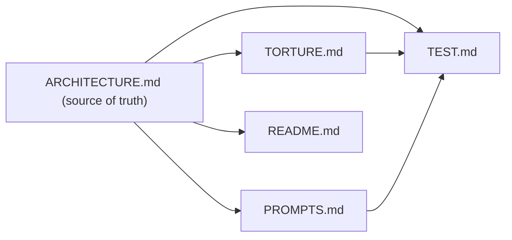
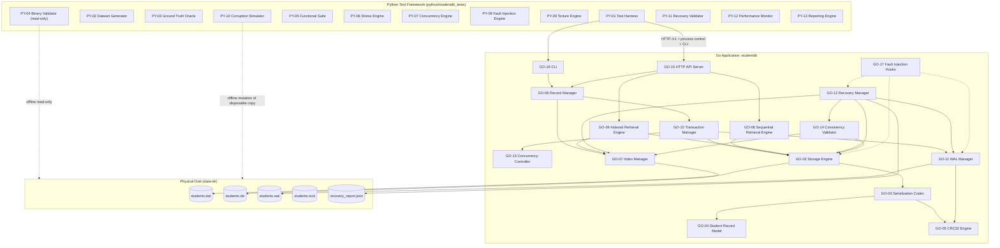
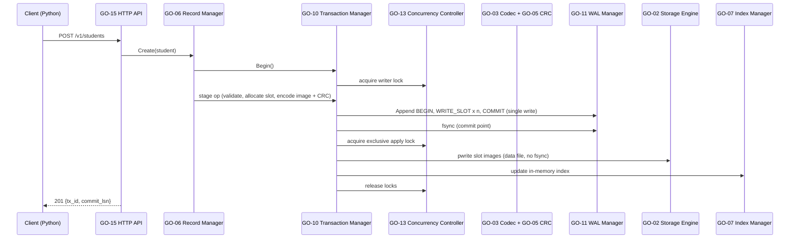
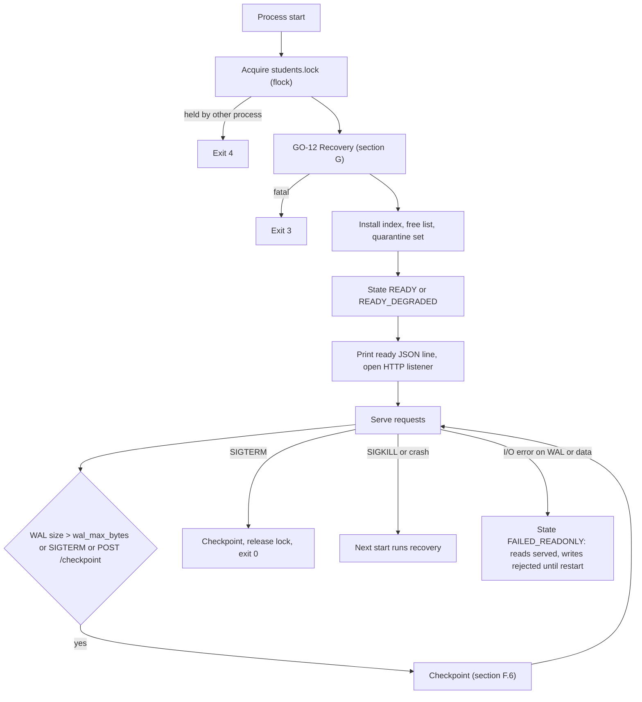
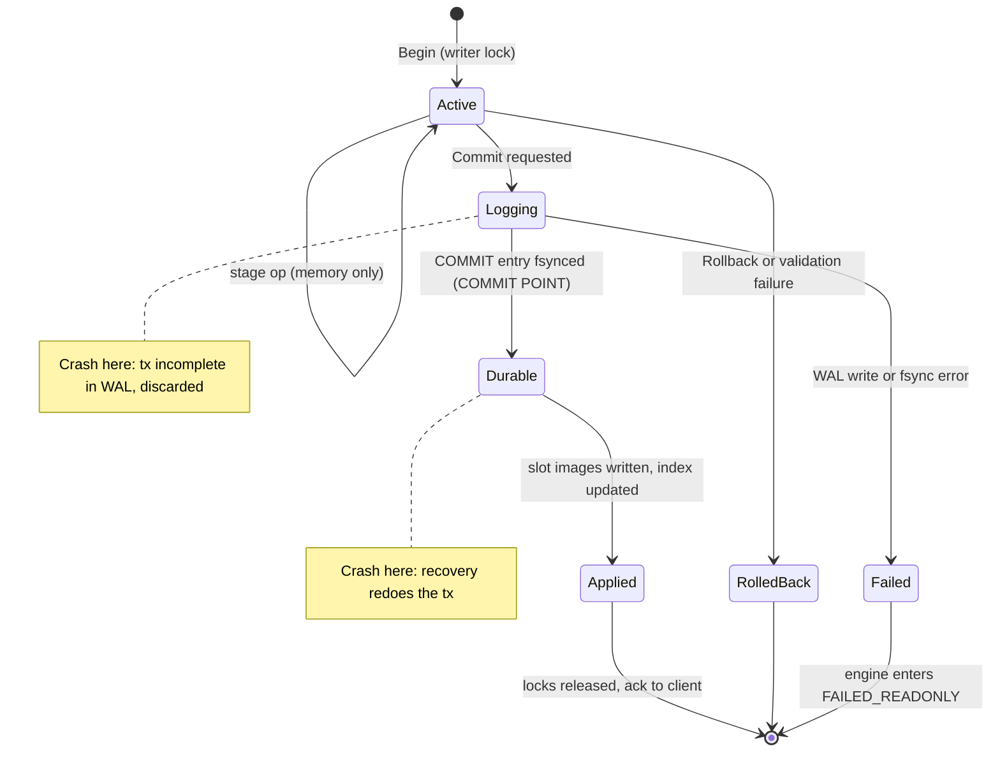
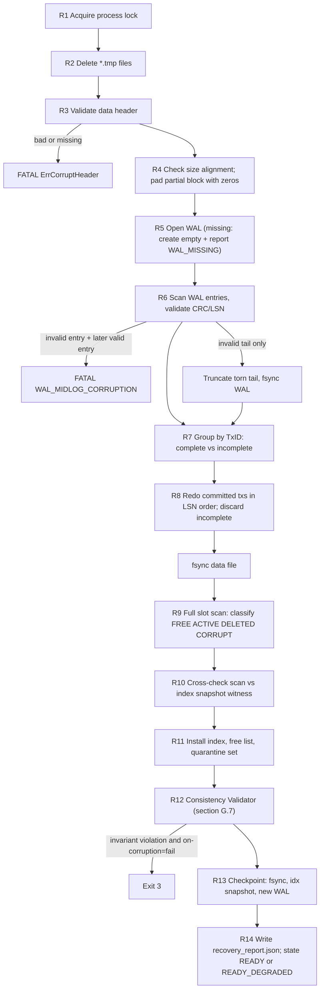
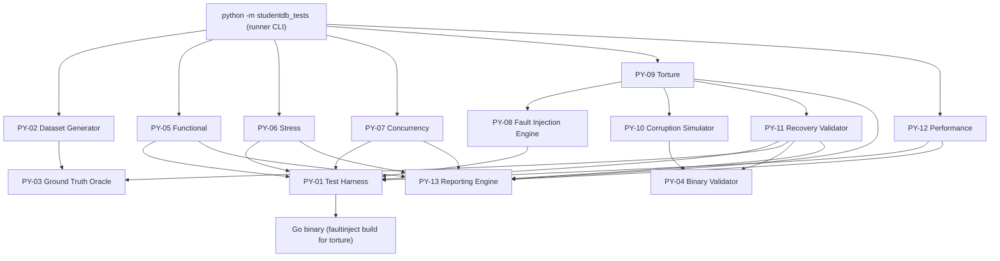
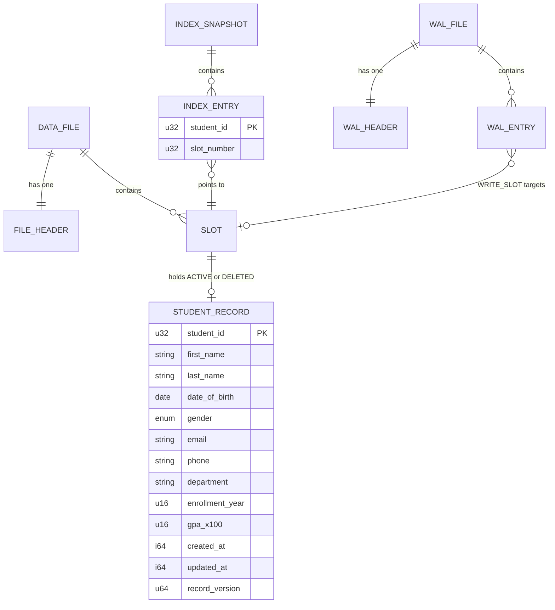

# ARCHITECTURE.md — BinStudentDB: Go Binary Student Database with Python Torture Testing

| Field | Value |
|---|---|
| Document version | 1.0 |
| Status | Design only. No implementation exists. Every command, API, file, and metric named here is a specification. |
| Authority | **Single source of truth.** [TORTURE.md](TORTURE.md), [PROMPTS.md](PROMPTS.md), [TEST.md](TEST.md), and [README.md](README.md) derive from this file. On conflict, this file wins. |
| Canonical constants | Appendix A |
| Component registry | Appendix B |

## Document Map



**Conventions.** MUST/SHOULD/MAY carry RFC 2119 meaning. All integers are **little-endian**. Component IDs (`GO-xx`, `PY-xx`) are fixed and used in every document. "Slot" means one fixed-size 256-byte record position in the data file.

---

# A. System Overview

## A.1 Project Introduction
BinStudentDB is a single-node, embedded-style database that stores student records in a **binary file on a physical disk**. Each record carries a **CRC32** checksum, and a **Write-Ahead Log (WAL)** provides crash consistency. It is written in **Go**. A separate **Python** framework tests, stress-tests, fault-injects, and "tortures" it through a documented HTTP/CLI interface.

## A.2 Problem Statement
An existing dataset of about 1,000 student/person records must be stored durably in binary form and retrieved reliably. We need evidence that the store (1) detects corruption, (2) survives abrupt termination without losing acknowledged data, (3) retrieves quickly, and (4) can grow well past 1,000 records.

## A.3 Objectives
| ID | Objective |
|---|---|
| O1 | Durable binary storage of student records with fixed-size slots. |
| O2 | Per-record CRC32 detection of accidental corruption. |
| O3 | Atomic, durable transactions via WAL (redo-only, no-steal). |
| O4 | Automatic crash recovery with a structured recovery report. |
| O5 | Sequential and indexed retrieval with measurable latency. |
| O6 | Safe concurrent access within one process (many readers, one writer at a time). |
| O7 | Reproducible, isolated Python fault-injection and torture testing. |
| O8 | Scalability from 1,000 to at least 100,000 records without format changes. |

## A.4 System Boundaries
| In scope | Out of scope (v1) |
|---|---|
| Single process, single node, local disk | Replication, clustering, distributed transactions |
| Fixed-schema Student record | Arbitrary schemas, SQL, secondary persisted indexes |
| HTTP (loopback) + CLI interfaces | Remote/public network exposure, TLS |
| CRC32 accidental-corruption detection | Cryptographic integrity, encryption at rest, malicious tampering resistance |
| Process-crash recovery, torn-write recovery | Hardware repair, RAID, automatic repair of unrecoverable media corruption |
| Offline (cold) backup | Online/hot backup, point-in-time recovery |
| Linux (primary), macOS (secondary) | Windows (not supported in v1) |

## A.5 Functional Requirements
| ID | Requirement |
|---|---|
| FR-01 | Create a student record (caller-supplied `StudentID`, unique). |
| FR-02 | Read a record by `StudentID` (indexed). |
| FR-03 | Update a record (full replacement). |
| FR-04 | Delete a record (tombstone; slot reusable). |
| FR-05 | Multi-operation atomic transactions (max 1,000 ops). |
| FR-06 | Sequential retrieval in physical slot order with optional equality filters. |
| FR-07 | Indexed retrieval: point lookup and `StudentID` range. |
| FR-08 | Verify CRC32 on every record read and on full-scan verification. |
| FR-09 | WAL-protected writes; checkpointing; WAL truncation. |
| FR-10 | Automatic recovery at startup; JSON recovery report. |
| FR-11 | Consistency validation (online and offline). |
| FR-12 | Concurrent access: many readers, serialized writers. |
| FR-13 | Offline CSV import of an existing dataset. |
| FR-14 | Offline backup of a stopped database with SHA-256 manifest. |
| FR-15 | Fault-injection hooks, compiled only under the `faultinject` build tag. |

## A.6 Non-Functional Requirements
| ID | Requirement | Measurable target (calibrate after first measured run) |
|---|---|---|
| NFR-01 | Durability | Zero acknowledged-commit loss under process kill (`sync_mode=always`). |
| NFR-02 | Integrity | 100% detection of injected single-bit and ≤32-bit burst corruption inside CRC-covered bytes. |
| NFR-03 | Recovery time | ≤ 5 s for 100,000 records, full verification, reference SSD. |
| NFR-04 | Point lookup | p99 ≤ 1 ms at 100,000 records (warm). |
| NFR-05 | Stability | No panic/hang across the torture profiles defined in [TORTURE.md](TORTURE.md) §D.3, judged by the criteria in [TEST.md](TEST.md) §G. |
| NFR-06 | Reproducibility | Every torture iteration replayable from `(seed, failpoint spec, binary hash)`. |
| NFR-07 | Portability | Standard library only for the Go application; no cgo. |
| NFR-08 | Observability | Structured logs; no PII (email, phone) in logs. |

---

# B. High-Level Architecture

## B.1 System Architecture



## B.2 Go Application Architecture

**Layering (dependencies point downward only; no cycles):**

| Layer | Packages (`internal/…`) | May import |
|---|---|---|
| L0 Leaf | `crc`, `record`, `faultinject`, `concurrency`, `index` | stdlib only |
| L1 Format | `codec` | `record`, `crc` |
| L2 Persistence | `storage`, `wal` | `codec`, `crc`, `faultinject` |
| L3 Services | `tx`, `retrieval`, `verify` | L0–L2 |
| L4 Orchestration | `recovery`, `engine` | L0–L3 (`recovery` imports `verify`; `verify` never imports `recovery`) |
| L5 Interfaces | `httpapi`, `cmd/studentdb` | `engine`, `recovery`, `verify` |

**Explicit interfaces (SOLID/DIP).** Higher layers depend on interfaces, not concrete types: `SlotStore` (storage), `LogWriter` / `LogReader` (wal), `IndexStore` (index), `LockManager` (concurrency), `FailpointRegistry` (faultinject). Fakes of these interfaces enable unit tests. Production builds bind the real implementations; `faultinject` builds additionally bind real failpoints.

## B.3 Python Testing Architecture (summary; detail in §H)
Python never reimplements database logic. It (1) starts/kills/restarts the Go binary as a subprocess, (2) talks to it over documented HTTP/CLI, (3) keeps an in-memory **oracle** (a dictionary of expected state, not a database), and (4) inspects files **read-only** with an independent format decoder.

## B.4 Go ↔ Python Interface Contract
| Channel | Purpose | Contract |
|---|---|---|
| Process | Lifecycle | Python spawns `studentdb serve`. On readiness the server prints one JSON line to stdout: `{"event":"ready","addr":"127.0.0.1:<port>","state":"READY\|READY_DEGRADED","recovery_report":"<path>"}`. `--addr 127.0.0.1:0` picks an ephemeral port. No request is accepted before recovery completes. |
| HTTP `/v1` | Data + admin | Table in §E.9. JSON bodies. Loopback only. |
| CLI | Offline operations | `init`, `import`, `verify`, `recover`, `checkpoint`, `stats`, `dump`, `backup`, `version` (§E.10). Exit codes: 0 ok, 1 usage, 2 verify failed, 3 recovery fatal, 4 data-dir locked. |
| Signals | Abrupt termination | SIGKILL (abrupt), SIGTERM (graceful: checkpoint then exit 0). |
| Files | Post-mortem | Offline read of `students.dat/.idx/.wal`, `recovery_report.json`, and (fault-inject builds) `durability.ledger`. |
| Build capability | Safety gate | `studentdb version --json` and `GET /v1/admin/capabilities` report `build: "production"` or `"faultinject"`. Torture tests MUST refuse a `production` binary. |

## B.5 Component Interaction

**Write path (insert/update/delete/batch):**



**Read path:** `API → GO-09 → Index (RLock) → Storage pread(256) → CRC verify → decode → verify StudentID matches key → response`.

## B.6 System Execution Flow



---

# C. Storage Architecture

## C.1 Physical Disk Storage Model
All state lives in one **data directory** (default `data/live/`). Directory mode `0700`, file mode `0600`.

| File | Role | Authority |
|---|---|---|
| `students.dat` | Header block + record slots | **Authoritative** for record contents once WAL entries are applied. |
| `students.wal` | Redo log | Authoritative for committed-but-not-yet-checkpointed changes. |
| `students.idx` | Persisted snapshot of the primary index | **Derived.** Always rebuildable by scanning `students.dat`. Used as an independent witness for loss detection (§G.6). |
| `students.lock` | Advisory `flock` file | Prevents two processes opening one database. |
| `recovery_report.json` | Output of the last startup recovery | Informational. |
| `durability.ledger` | `faultinject` builds only: records last fsynced length per file | Test oracle only. |
| `*.tmp` | Temporary files for atomic replace (`students.idx.tmp`, `students.wal.tmp`) | Never trusted; deleted at startup. |

## C.2 Binary File Organization (`students.dat`)

```
Offset 0      +-------------------------------+
              | File header (4096 bytes)      |  HeaderSize
Offset 4096   +-------------------------------+
              | Block 0: slots 0..15          |  16 x 256 B = 4096 B
              +-------------------------------+
              | Block 1: slots 16..31         |
              +-------------------------------+
              | ...                           |
              +-------------------------------+
```

### File Header (4096 bytes, written once at `init` via temp file + rename)
| Offset | Size | Field | Value / Notes |
|---|---|---|---|
| 0 | 8 | Magic | ASCII `BSDBDATA` |
| 8 | 2 | FormatVersion | `1` |
| 10 | 2 | Reserved | 0 |
| 12 | 4 | HeaderSize | 4096 |
| 16 | 4 | BlockSize | 4096 |
| 20 | 4 | RecordSize | 256 |
| 24 | 4 | SlotsPerBlock | 16 |
| 28 | 8 | CreatedAtUnix | int64 seconds |
| 36 | 16 | DatabaseUUID | random, also echoed in `recovery_report.json` |
| 52 | 4040 | Reserved | zero |
| 4092 | 4 | HeaderCRC32 | CRC32 over bytes `[0, 4092)` |

The header is **immutable after init**, so it cannot be torn by a crash. `SlotCount` is **derived**: `(FileSize − 4096) / 256`.

## C.3 Record Layout (256 bytes per slot)

| Offset | Size | Field | Type | Notes |
|---|---|---|---|---|
| 0 | 2 | Magic | u16 | `0x5352` |
| 2 | 1 | RecordFormat | u8 | `1` |
| 3 | 1 | Status | u8 | `0` FREE, `1` ACTIVE, `2` DELETED |
| 4 | 4 | StudentID | u32 | `1 … 4,294,967,295`; `0` invalid |
| 8 | 8 | RecordVersion | u64 | `TxID` of the last writing transaction |
| 16 | 32 | FirstName | UTF-8, NUL-padded | |
| 48 | 32 | LastName | UTF-8, NUL-padded | |
| 80 | 4 | DateOfBirth | i32 | days since 1970-01-01 |
| 84 | 1 | Gender | u8 | 0 unspecified, 1 female, 2 male, 3 other |
| 85 | 3 | Reserved | | zero |
| 88 | 64 | Email | UTF-8, NUL-padded | |
| 152 | 20 | Phone | ASCII, NUL-padded | |
| 172 | 24 | Department | UTF-8, NUL-padded | |
| 196 | 2 | EnrollmentYear | u16 | 1950–2100 |
| 198 | 2 | GPAx100 | u16 | 0–400 |
| 200 | 8 | CreatedAt | i64 | Unix seconds (server clock) |
| 208 | 8 | UpdatedAt | i64 | Unix seconds (server clock) |
| 216 | 36 | Reserved | | zero |
| 252 | 4 | CRC32 | u32 | IEEE CRC32 over bytes `[0, 252)` |

**Special slot states**
- **FREE** = all 256 bytes zero. This is the only valid FREE encoding, and the CRC check is skipped for it (see CRC limitations, §D.7).
- **DELETED** (tombstone) = valid CRC, Status=2, `StudentID` and `RecordVersion` retained, all other data fields zeroed.
- Any other slot with a CRC mismatch, bad Magic, unknown Status, or non-zero reserved/padding bytes is **CORRUPT**.

## C.4 Serialization and Deserialization
- **Canonical encoding:** fixed offsets, little-endian, strings NUL-padded. `encode(decode(x)) == x` MUST hold for every valid slot; the decoder rejects non-zero bytes after the first NUL of a string field and non-zero reserved bytes (strictness makes corruption observable).
- **Encode order:** validate model → write fields → zero reserved → compute CRC32 over `[0,252)` → store at 252.
- **Decode order:** length check (exactly 256) → all-zero check (FREE) → CRC verify → Magic/Format/Status check → field decode and range validation.
- **Date mapping:** `DateOfBirth` ↔ days since epoch (proleptic Gregorian, UTC).
- **Money/GPA:** stored as integer hundredths; API uses decimal with 2 places.

## C.5 File Offsets and Addressing
| Quantity | Formula |
|---|---|
| Slot byte offset | `4096 + slot × 256` |
| Block of a slot | `slot ÷ 16` |
| Slot count | `(FileSize − 4096) ÷ 256` (file size MUST be `4096 + k×4096`) |
| Max slot number | `2³² − 2` |
| Index entry → record | `SlotNumber` from `students.idx`/memory → offset formula above |

## C.6 Storage Allocation
1. **Free list:** an in-memory min-heap of slot numbers whose state is FREE or DELETED, rebuilt at startup by the full scan. Allocation takes the lowest free slot (locality).
2. **Growth:** when no free slot exists, the file grows by one block (16 zero slots). Growth is performed by writing real zero bytes (not a sparse `ftruncate`) so ENOSPC surfaces at allocation time.
3. **Reservation:** slots are reserved during staging and released if the transaction aborts. A reserved slot is not visible to other writers (single writer).
4. **Quarantine:** CORRUPT slots are never reused or overwritten until an operator action (future feature) resolves them.
5. **No shrink:** the file never shrinks in v1.

## C.7 Data Consistency Rules
- **Never assume sector-atomic writes.** A 256-byte slot write may tear. WAL redo repairs any slot written after the last checkpoint (the WAL is retained until the data file is fsynced).
- **Write ordering** is defined in §F.4 and MUST NOT be reordered.
- **Single source of truth per fact:** record contents → `students.dat`; committed-pending changes → WAL; index → derived.
- **Index never leads data:** the in-memory index is updated only after the slot write completes.

## C.8 Component Specifications

### GO-02 Storage Engine (`internal/storage`)
| Attribute | Description |
|---|---|
| Purpose | Own `students.dat`: header, slot I/O, growth, allocation, sync. |
| Responsibilities | Create/open/validate file; `ReadSlot`, `WriteSlot` (pwrite), `Extend`, `Sync`; free-list allocator; sequential chunk reads; honor failpoints. |
| Inputs | Slot number + 256-byte image; data-dir path; sync mode. |
| Outputs | 256-byte images; slot count; errors (`ErrDiskFull`, `ErrChecksumMismatch` via codec, `ErrCorruptHeader`). |
| Dependencies | GO-03, GO-05, GO-17. |
| Failure scenarios | Torn slot write; short write; ENOSPC; EIO on fsync (never retried; engine → FAILED_READONLY); truncated file; bad header. |
| Testing | TEST.md §B.1 (ST-xx); torn-write and truncation scenarios T04, T07 in TORTURE.md. |

### GO-03 Serialization Codec (`internal/codec`)
| Attribute | Description |
|---|---|
| Purpose | Convert Student ↔ 256-byte slot image; encode/decode header, WAL entries, index file. |
| Responsibilities | Canonical encoding rules (§C.4); strict decode; CRC stamping/verification via GO-05. |
| Inputs | `record.Student` or `[]byte`. |
| Outputs | `[]byte` (256 B) or `record.Student`; `ErrInvalidRecord`, `ErrChecksumMismatch`. |
| Dependencies | GO-04, GO-05. |
| Failure scenarios | Oversized string; NUL in string; invalid UTF-8; non-canonical padding; wrong length input. |
| Testing | TEST.md §B.2 (SE-xx): round-trip, fuzz, golden byte vectors shared with PY-04. |

### GO-04 Student Record Model (`internal/record`)
| Attribute | Description |
|---|---|
| Purpose | Define the in-memory `Student` type and validation rules (§I.2). |
| Responsibilities | Field types, constraints, normalization (trim), conversion helpers (date ↔ days, GPA ↔ ×100). |
| Inputs | Raw field values (from API/CSV). |
| Outputs | Validated `Student` or `ErrValidation` listing every violated field. |
| Dependencies | None. |
| Failure scenarios | Out-of-range values; byte-length overflow after UTF-8 encoding. |
| Testing | TEST.md §B.2 (SE-xx validation cases), §B.4 (CU-xx). |

## C.9 Storage Testing Strategy
Unit tests with in-memory/fake `SlotStore`; integration tests on real temp files; golden binary vectors cross-checked by PY-04; torture scenarios T04/T07/T13.

---

# D. CRC Architecture

## D.1 CRC32 Implementation
- **GO-05 CRC32 Engine** (`internal/crc`) wraps Go `hash/crc32` with the **IEEE polynomial** (reflected `0xEDB88320`, init `0xFFFFFFFF`, final XOR `0xFFFFFFFF`).
- IEEE is chosen so Python's `zlib.crc32` produces identical values, enabling PY-04 to verify independently.

## D.2 Checksum Generation
| Structure | Covered bytes | Stored at |
|---|---|---|
| Record slot | `[0,252)` | `[252,256)` |
| Data file header | `[0,4092)` | `[4092,4096)` |
| WAL file header | `[0,28)` | `[28,32)` |
| WAL entry | `[0, 32+PayloadLen)` (entry header + payload) | last 4 bytes of the entry |
| Index file | entire file except trailer | last 4 bytes |

Generation happens in GO-03 at encode time, always last, after all other bytes are final.

## D.3 Checksum Storage
Little-endian u32 at the end of each covered structure. Embedding the CRC in the slot means a WAL `WRITE_SLOT` payload carries a self-verifying image, so recovery writes only slots that already passed the CRC.

## D.4 Checksum Verification Points
| Point | Trigger | On mismatch |
|---|---|---|
| Point read | Every `GET /students/{id}` | `ErrChecksumMismatch` → HTTP 500 `CHECKSUM_MISMATCH` |
| Sequential scan | Every slot visited | Reported in `errors[]`; scan continues (unless `strict`) |
| Startup full scan | Every slot (`startup_verify=full`, default) | Slot quarantined; reported |
| WAL replay | Every entry | Torn tail truncated, or FATAL if mid-log (§G.4) |
| Index load | Trailer CRC | Snapshot discarded; index rebuilt |
| Header open | Header CRC | FATAL `ErrCorruptHeader` |
| Online/offline verify | I3 in §G.7 | Reported; exit 2 offline |

## D.5 Corruption Detection
A record is **valid** only if (a) it is all-zero (FREE) or (b) CRC, Magic, RecordFormat, Status, and padding rules all hold. Failure of any rule is *corruption*. Detection never mutates the slot.

## D.6 Error Handling
Errors wrap sentinel `ErrChecksumMismatch` with `slot`, `offset`, `stored_crc`, `computed_crc` (no field values, to avoid PII in logs). A read never returns partial or unverified data.

## D.7 CRC Limitations (normative)
1. CRC32 detects **accidental** corruption only; it is not tamper-proof.
2. Guarantees: all single-bit errors, all burst errors ≤ 32 bits, and any odd number of bit errors (IEEE polynomial has factor `x+1`). Random multi-byte corruption evades detection with probability ≈ 2⁻³².
3. **Whole-slot zeroing** produces a valid FREE slot and is **not** detectable by CRC; it is detected only through the index-snapshot witness (§G.6) or the oracle.
4. **Stale/lost writes** (an old valid record reappearing) and **misdirected writes** (valid record in the wrong slot) are not detected by CRC. Partial mitigations: `RecordVersion` monotonicity checks, index↔slot `StudentID` cross-check (I7).
5. **CRC is not crash recovery.** Detecting a torn slot says nothing about restoring it. Restoration is the job of the WAL (GO-11) and Recovery Manager (GO-12).

### GO-05 CRC32 Engine (`internal/crc`)
| Attribute | Description |
|---|---|
| Purpose | Single implementation of CRC32-IEEE used everywhere. |
| Responsibilities | `Sum(bytes)`, streaming update, constant-time compare helper. |
| Inputs | Byte slices. |
| Outputs | `uint32`. |
| Dependencies | stdlib `hash/crc32`. |
| Failure scenarios | None at runtime (pure function); misuse = wrong range (tested). |
| Testing | TEST.md §B.3 (CR-xx): known vectors (`"123456789"` → `0xCBF43926`), cross-check vs Python `zlib.crc32`, bit-flip sweeps. |

---

# E. Database Engine

## E.1 Record Management (GO-06 Record Manager, `internal/engine`)
| Attribute | Description |
|---|---|
| Purpose | Public CRUD facade over transactions, index, and storage. |
| Responsibilities | Validate input; resolve `StudentID` via index; allocate slots; stage ops in a transaction; assemble responses; enforce uniqueness. |
| Inputs | `Student` (create/update), `StudentID` (read/delete), op lists (batch). |
| Outputs | `Student`, `{tx_id, commit_lsn}`, sentinel errors (§E.8). |
| Dependencies | GO-04, GO-07, GO-10, GO-02, GO-09, GO-13. |
| Failure scenarios | Duplicate ID; not found; validation failure; ErrDiskFull; engine FAILED_READONLY; lock timeout (`ErrBusy`). |
| Testing | TEST.md §B.4 (CU-xx). |

## E.2 CRUD Semantics
| Operation | Behavior |
|---|---|
| Create | Fails `ErrDuplicateID` if ID exists as ACTIVE. Allocates a slot; image Status=ACTIVE; sets `CreatedAt=UpdatedAt=now`. |
| Read | Index lookup → slot read → CRC → decode → ID cross-check. |
| Update | Full replacement of user fields; same slot; `CreatedAt` preserved; `UpdatedAt=now`; `RecordVersion=TxID`. `ErrNotFound` if absent. |
| Delete | Writes a tombstone image to the slot; slot becomes reusable **after** apply; index entry removed. |
| Batch | Ops validated against *staged* state (e.g., insert then update same ID in one tx is allowed). Any failure aborts the whole batch before anything is logged. |

## E.3 Sequential Retrieval (GO-08, `internal/retrieval`)
| Attribute | Description |
|---|---|
| Purpose | Read records in physical slot order without using the index. |
| Responsibilities | Chunked `pread` (256 slots / 64 KiB); skip FREE/DELETED; verify CRC per slot; apply equality filters (`department`, `enrollment_year`, `last_name`); cursor = next slot; page size ≤ 1,000. |
| Inputs | `cursor`, `limit`, filters, `strict` flag. |
| Outputs | `items[]`, `errors[]` (slot, offset, kind), `next_cursor`. |
| Dependencies | GO-02, GO-13 (RLock per page). |
| Failure scenarios | CORRUPT slot (reported; `strict` aborts); file grows between pages; read I/O error. |
| Testing | TEST.md §B.5 (SQ-xx). Consistency between pages is read-committed (each page is consistent). |

## E.4 Indexed Retrieval (GO-09, `internal/retrieval`)
| Attribute | Description |
|---|---|
| Purpose | O(log n) point lookup and ordered range scans by `StudentID`. |
| Responsibilities | Index lookup; slot fetch; CRC; **verify `record.StudentID == key` and Status=ACTIVE** else `ErrIndexInconsistent`. |
| Inputs | `StudentID`, or `[from,to]` + `limit`. |
| Outputs | `Student` / ordered list / `next_from`. |
| Dependencies | GO-07, GO-02, GO-13. |
| Failure scenarios | Index points to FREE/other-ID slot; slot CORRUPT; out-of-range slot. |
| Testing | TEST.md §B.6 (IR-xx); TORTURE T08, T13. |

## E.5 Index Maintenance (GO-07 Index Manager, `internal/index`)
| Attribute | Description |
|---|---|
| Purpose | Primary index `StudentID → SlotNumber`. |
| Responsibilities | In-memory B+tree (no third-party dependency); insert/delete/lookup/range; snapshot save/load (`students.idx`); rebuild from a slot scan; entry count. |
| Inputs | `(StudentID, Slot)` mutations; snapshot file; scan results. |
| Outputs | Slot numbers; ordered iterators; snapshot file. |
| Dependencies | stdlib; codec helpers for the snapshot file CRC. |
| Failure scenarios | Corrupt/stale/truncated snapshot (discard + rebuild); duplicate key on rebuild (conflict reported by GO-12). |
| Testing | TEST.md §B.7 (IX-xx); TORTURE T08. |

**Index file format (`students.idx`)**
| Offset | Size | Field |
|---|---|---|
| 0 | 4 | Magic `BSIX` |
| 4 | 2 | Version `1` |
| 6 | 2 | Reserved |
| 8 | 8 | EntryCount |
| 16 | 8 | CheckpointLSN |
| 24 | 8 | SlotCount at snapshot time |
| 32 | 8×N | Entries sorted by StudentID: `StudentID u32`, `SlotNumber u32` |
| 32+8N | 4 | CRC32 over all preceding bytes |

Written as `students.idx.tmp` → fsync → atomic rename → fsync directory. The snapshot is **valid for fast load** only if the trailer CRC verifies **and** `CheckpointLSN == WAL header CheckpointLSN` **and** no WAL entries were replayed.

## E.6 Transaction Management (GO-10, `internal/tx`)
| Attribute | Description |
|---|---|
| Purpose | Atomic, durable, isolated groups of operations. |
| Responsibilities | `Begin` (take writer lock); staging (ops, slot reservations, images in memory); `Commit` (§F.3); `Rollback` (discard staging, release reservations); enforce max 1,000 ops; assign monotonic `TxID`. |
| Inputs | Op list; sync mode. |
| Outputs | `{tx_id, commit_lsn}` or error. |
| Dependencies | GO-11, GO-02, GO-13, GO-03, GO-04. |
| Failure scenarios | WAL append failure (→ FAILED_READONLY); crash between commit-fsync and apply (recovered by redo); lock timeout. |
| Testing | TEST.md §B.8–B.9; TORTURE T01–T03, T15. |

**Properties:** Atomicity (all-or-nothing via WAL COMMIT), Consistency (invariants §G.7), Isolation (serial writers; readers see only committed, applied state), Durability (fsync of COMMIT, `sync_mode=always`).

## E.7 Concurrency Control (GO-13, `internal/concurrency`)
| Attribute | Description |
|---|---|
| Purpose | Make in-process concurrent access safe and deadlock-free. |
| Responsibilities | Three locks with a fixed order: **(1) `writer` mutex** (serializes transactions) → **(2) `state` RWMutex** (readers shared; apply phase and checkpoint exclusive) → none else. Process-level `flock` on `students.lock`. Timeouts (`tx_lock_timeout` 5 s → `ErrBusy`). |
| Inputs | Lock requests with context. |
| Outputs | Lock handles; `ErrBusy`, `ErrLocked`. |
| Dependencies | stdlib `sync`, `syscall.Flock`. |
| Failure scenarios | Writer starvation; reader blocked during long apply; second process opens the same directory (`ErrLocked`, exit 4). |
| Testing | TEST.md §B.11 (CC-xx); Go `-race`; PY-07. |

**Rules:** the WAL write+fsync happens while holding only `writer` (readers continue); only the short *apply* window holds `state` exclusively. Readers never take `writer`. Checkpoint takes `writer` then `state`. Isolation level = serializable for writers, read-committed per request/page for readers.

## E.8 Error Taxonomy
| Sentinel | HTTP | API `code` |
|---|---|---|
| `ErrValidation` | 422 | `VALIDATION_FAILED` |
| `ErrNotFound` | 404 | `NOT_FOUND` |
| `ErrDuplicateID` | 409 | `DUPLICATE_ID` |
| `ErrChecksumMismatch` | 500 | `CHECKSUM_MISMATCH` |
| `ErrInvalidRecord` | 500 | `INVALID_RECORD` |
| `ErrIndexInconsistent` | 500 | `INDEX_INCONSISTENT` |
| `ErrDiskFull` | 507 | `DISK_FULL` |
| `ErrEngineFailed` | 503 | `ENGINE_FAILED_READONLY` |
| `ErrBusy` | 503 | `BUSY` |
| `ErrCorruptWAL` | (startup) | exit 3 |
| `ErrCorruptHeader` | (startup) | exit 3 |
| `ErrLocked` | (startup) | exit 4 |

## E.9 HTTP API v1 (GO-15 HTTP API Server, `internal/httpapi`)
Loopback only. Bodies ≤ 1 MiB. Admin endpoints require `Authorization: Bearer <STUDENTDB_ADMIN_TOKEN>` when the token is set.

| Method & Path | Purpose | Success |
|---|---|---|
| `POST /v1/students` | Create | `201 {student, tx_id, commit_lsn}` |
| `GET /v1/students/{id}` | Indexed point read | `200 student` |
| `PUT /v1/students/{id}` | Update (replace) | `200 {student, tx_id, commit_lsn}` |
| `DELETE /v1/students/{id}` | Delete | `200 {tx_id, commit_lsn}` |
| `POST /v1/tx` | Atomic batch: `{"ops":[{"op":"insert\|update\|delete", "student":{…} \| "student_id":N}]}` | `200 {tx_id, commit_lsn, results[]}` |
| `GET /v1/students?mode=scan&cursor=&limit=&department=&enrollment_year=&last_name=&strict=` | Sequential retrieval | `200 {items[], errors[], next_cursor}` |
| `GET /v1/students?mode=index&from=&to=&limit=` | Indexed range | `200 {items[], next_from}` |
| `GET /v1/health` | State: `RECOVERING \| READY \| READY_DEGRADED \| FAILED_READONLY` | `200` |
| `GET /v1/admin/stats` | Counts, slot count, WAL size, last checkpoint LSN | `200` |
| `GET /v1/admin/verify` | Online consistency validation (§G.7) | `200 {ok, findings[]}` |
| `POST /v1/admin/checkpoint` | Force checkpoint | `200 {checkpoint_lsn}` |
| `POST /v1/admin/shutdown` | Graceful shutdown | `202` |
| `GET /v1/admin/capabilities` | `{build, format_version, sync_mode, startup_verify}` | `200` |
| `GET/POST/DELETE /v1/admin/failpoints` | **`faultinject` builds only** (§H.4) | `200` |

Student JSON fields: `student_id`, `first_name`, `last_name`, `date_of_birth` (`YYYY-MM-DD`), `gender` (`unspecified\|female\|male\|other`), `email`, `phone`, `department`, `enrollment_year`, `gpa` (0.00–4.00), read-only `created_at`/`updated_at` (RFC 3339 UTC) and `record_version`.

## E.10 CLI (GO-16, `cmd/studentdb`)
| Command | Purpose | Requires stopped DB? |
|---|---|---|
| `init --data-dir D` | Create empty database files | n/a |
| `import --data-dir D --input students.csv` | Transactional CSV import (batches of 100) | Yes |
| `serve --data-dir D --addr A [flags]` | Run recovery then serve HTTP | n/a |
| `verify --data-dir D` | Offline full validation (§G.7), exit 2 on failure | Yes |
| `recover --data-dir D` | Run recovery only; print report | Yes |
| `checkpoint --data-dir D` | Recover + checkpoint + exit | Yes |
| `stats --data-dir D` | Print counts | Yes |
| `dump --data-dir D [--format json\|csv]` | Sequential dump | Yes |
| `backup --data-dir D --dest B` | Cold backup + SHA-256 manifest | Yes |
| `version [--json]` | Version, format version, build tag | No |

**Flags for `serve`:** `--sync-mode always|none` (`none` is unsafe; benchmarks only), `--startup-verify full|fast` (default `full`), `--on-corruption quarantine|fail` (default `quarantine`), `--wal-max-bytes` (default 4 MiB), `--log-level`.

---

# F. WAL Architecture

## F.1 WAL Design Summary
**Redo-only, no-steal** logging with after-images of whole slots. Data-file pages are modified **only after** the transaction's COMMIT is durable in the WAL; therefore no undo log is needed, and rollback never touches the data file.

### GO-11 WAL Manager (`internal/wal`)
| Attribute | Description |
|---|---|
| Purpose | Durable, self-verifying redo log. |
| Responsibilities | Create/open WAL; append a whole transaction in one write; fsync; sequential reader with validation and resync; atomic WAL rotation at checkpoint; truncation of torn tail; failpoints. |
| Inputs | Transaction (slot images), LSN/TxID state; recovery read requests. |
| Outputs | `commit_lsn`; validated entry stream; scan summary (`valid_entries`, `torn_tail_bytes`, `midlog_corruption`). |
| Dependencies | GO-05, GO-17. |
| Failure scenarios | Partial write; ENOSPC; fsync EIO; torn tail; mid-log corruption; LSN gap. |
| Testing | TEST.md §B.8 (WL-xx); TORTURE T09, T10. |

## F.2 Log Entry Structure
**WAL file header (32 bytes)**
| Offset | Size | Field |
|---|---|---|
| 0 | 4 | Magic `BSWL` |
| 4 | 2 | Version `1` |
| 6 | 2 | Reserved |
| 8 | 8 | CheckpointLSN (all effects ≤ this LSN are durable in `students.dat`) |
| 16 | 8 | NextTxID |
| 24 | 4 | Reserved |
| 28 | 4 | HeaderCRC32 over `[0,28)` |

**Entry (variable length)**
| Offset | Size | Field |
|---|---|---|
| 0 | 4 | EntryMagic = ASCII `WALE` (resync marker) |
| 4 | 4 | TotalLength (`32 + PayloadLen + 4`) |
| 8 | 8 | LSN (strictly increasing by 1, first = CheckpointLSN+1) |
| 16 | 8 | TxID |
| 24 | 1 | Type: `1` BEGIN, `2` WRITE_SLOT, `3` COMMIT |
| 25 | 3 | Reserved |
| 28 | 4 | PayloadLen |
| 32 | PayloadLen | Payload |
| 32+PayloadLen | 4 | EntryCRC32 over `[0, 32+PayloadLen)` |

| Type | Payload | Entry size |
|---|---|---|
| BEGIN | empty | 36 B |
| WRITE_SLOT | `SlotNumber u32` + 256-byte slot image (already CRC-stamped) | 296 B |
| COMMIT | `OpCount u32` (number of WRITE_SLOT entries in this tx) | 40 B |

Maximum entries per tx: `1 + 1,000 + 1`. A WRITE_SLOT may only target `slot < SlotCount + MaxSlotGrowthPerTx (1,024)`.

## F.3 Transaction Lifecycle



## F.4 Write Ordering (normative; each step completes before the next)
| # | Rule |
|---|---|
| W1 | Stage ops in memory; WAL and data file untouched (no-steal). |
| W2 | Append `BEGIN, WRITE_SLOT×n, COMMIT` to the WAL with one `write` call. |
| W3 | `fsync(students.wal)` — **commit point** (skipped only if `sync_mode=none`). |
| W4 | Take exclusive `state` lock; `pwrite` each slot image to `students.dat` (extending first if needed). |
| W5 | Update the in-memory index; release locks; acknowledge the client. |
| W6 | Data file is **not** fsynced per commit. It is fsynced at checkpoint, before the WAL is truncated. |
| W7 | A WAL entry is never discarded until the data file changes it describes are fsynced. |
| W8 | Any WAL write or fsync error ⇒ no retry of fsync; state → `FAILED_READONLY`; a restart runs recovery. **Response semantics:** a failure *before* the commit point (W2/W3 write error, e.g. ENOSPC) returns the specific error (e.g. `507 DISK_FULL`) and the transaction is definitely **not** committed. A failure *after* the commit point (W3 succeeded; apply, sync, or checkpoint error) returns `503 ENGINE_FAILED_READONLY`, the outcome is **in doubt to the client**, and the transaction is redone by recovery. An fsync error at W3 is also in doubt. |

## F.5 Commit Mechanism
A transaction is committed **iff** its COMMIT entry is fully present, CRC-valid, has the matching `TxID`, and `OpCount` equals the number of preceding WRITE_SLOT entries of that `TxID`. Acknowledgement to clients happens after W5. A crash between W3 and the acknowledgement leaves the transaction **in doubt** to the client, but durable.

## F.6 Checkpointing
Triggers: WAL size ≥ `wal_max_bytes` (4 MiB), `POST /v1/admin/checkpoint`, graceful shutdown, end of recovery.

| Step | Action | Crash-safety note |
|---|---|---|
| K1 | Take `writer` then `state` locks | |
| K2 | `fsync(students.dat)` | Crash: WAL still complete. |
| K3 | Write `students.idx.tmp` (CheckpointLSN = L), fsync, rename over `students.idx`, fsync directory | Crash after rename: snapshot LSN ≠ WAL LSN ⇒ snapshot ignored, index rebuilt; WAL replay is idempotent. |
| K4 | Write `students.wal.tmp` with header `{CheckpointLSN=L, NextTxID}`, fsync, rename over `students.wal`, fsync directory | Atomic switch. |
| K5 | Reopen WAL for append; release locks | |

## F.6.1 Log Replay
Replay applies committed transactions **in LSN order**. Applying an after-image is **idempotent** and order-correct (the last committed image of a slot wins), so replaying already-applied entries, or replaying twice (crash during recovery), is safe.

## F.7 Rollback Strategy
Because of no-steal logging, rollback = discard staged ops, release slot reservations, release the writer lock. There is **no `ABORT` entry** in v1. Incomplete transactions found in the WAL after a crash are ignored by replay and removed when the WAL is rotated.

---

# G. Crash Recovery Architecture

## G.1 Failure Detection
| Signal | Meaning |
|---|---|
| Any WAL entries beyond header at startup | Previous run did not checkpoint (crash or `sync` shutdown) |
| WAL tail invalid | Torn append |
| Snapshot LSN ≠ WAL CheckpointLSN, or snapshot CRC bad | Crash mid-checkpoint or index damage |
| File size not `4096 + k×4096` | Truncation / interrupted growth |
| Slot CRC mismatch | Torn/corrupted slot |

Recovery is **always executed at startup**. A successful restart is **never** treated as proof of recovery; success is defined by the recovery report plus post-recovery validation (§G.7).

## G.2 Recovery Process (GO-12 Recovery Manager, `internal/recovery`)



| Attribute | Description |
|---|---|
| Purpose | Restore a consistent, verified database after any stop. |
| Responsibilities | Execute R1–R14; classify findings; never silently repair; produce report. |
| Inputs | Data directory; config (`startup_verify`, `on_corruption`). |
| Outputs | Live engine state; `recovery_report.json`; exit code on fatal. |
| Dependencies | GO-11, GO-02, GO-07, GO-14, GO-17. |
| Failure scenarios | Crash during recovery (idempotent; next start redoes); fatal header/WAL corruption; ENOSPC during redo. |
| Testing | TEST.md §B.10 (RC-xx); TORTURE T01–T15; PY-11. |

## G.3 Incomplete Transaction Handling
A transaction without a valid COMMIT is **rolled back** (ignored). It may be a trailing tail (normal) or, if followed by a later complete transaction, an inconsistency ⇒ FATAL `WAL_MIDLOG_CORRUPTION`. Rolled-back counts are reported (`uncommitted_discarded`).

## G.4 WAL Corruption Classification
On the first invalid entry the reader searches the remaining bytes for the next `WALE` marker whose entry validates. **None found** ⇒ torn tail (truncate, report `torn_tail_bytes`). **Found** ⇒ mid-log corruption: committed data may be unrecoverable; refuse to open automatically (FATAL), preserving the WAL for operator analysis.

## G.5 Index Reconstruction
The index is rebuilt from the R9 scan in every `startup_verify=full` start. With `startup_verify=fast`, the snapshot is loaded only when it is valid, LSN-matched, and no WAL entries were replayed; otherwise a scan is performed. Duplicate ACTIVE IDs: the higher `RecordVersion` wins; the other slot is quarantined and reported (`DUPLICATE_ID`).

## G.6 Corruption Quarantine and Loss Detection
- **CORRUPT slots** go to the quarantine set (rebuilt on each startup, not persisted). They are excluded from the index, never allocated, never overwritten; point reads of an ID whose slot is quarantined are impossible (ID untrusted), and scans report them in `errors[]`.
- **Snapshot witness (R10):** let `S` = IDs/slots in a valid snapshot, `D` = IDs/slots found by scan, `W` = slots touched by committed WAL entries. `S∖D` not explained by `W` ⇒ `SUSPECTED_DATA_LOSS` (e.g., zeroed slot, truncated file). `D∖S` not explained by `W` ⇒ `UNEXPLAINED_RECORD` (warning).
- State is `READY_DEGRADED` when quarantine or suspected loss is non-empty and `on_corruption=quarantine`.

## G.7 Consistency Validation (GO-14 Consistency Validator, `internal/verify`)
| Invariant | Statement |
|---|---|
| I1 | Data header valid. |
| I2 | File size = `4096 + k×4096`. |
| I3 | Every non-zero slot has a valid CRC and structure (else quarantined/reported). |
| I4 | No two ACTIVE slots share a `StudentID`. |
| I5 | Index entry set equals the set of ACTIVE slots (bijection). |
| I6 | Every indexed slot number `< SlotCount`. |
| I7 | Read-back: each indexed slot's `StudentID` equals its key. |
| I8 | After recovery, WAL holds zero entries (header only). |
| I9 | `stats.active_count` equals index size. |
| I10 | Free list ∩ (ACTIVE ∪ quarantine) = ∅. |

| Attribute | Description |
|---|---|
| Purpose | Prove structural consistency, online and offline. |
| Responsibilities | Evaluate I1–I10; emit structured findings `{invariant, severity, slot?, id?, detail}`. Online verify (`GET /v1/admin/verify`) runs I3–I7, I9, I10 under the `state` read lock. |
| Inputs | Storage, index, WAL reader. |
| Outputs | `{ok, findings[]}`; CLI exit 2 on failure. |
| Dependencies | GO-02, GO-07, GO-11 (reader only), GO-03. |
| Failure scenarios | Verify on a huge file takes long (bounded by throughput; chunked reads). |
| Testing | TEST.md §B.10 (RC-xx), VAL cases in §B.12; PY-04 cross-validates offline. |

## G.8 Recovery Report (`recovery_report.json`)
Fields: `db_uuid`, `started_at`, `duration_ms`, `wal_entries_scanned`, `torn_tail_bytes`, `tx_committed_redone`, `uncommitted_discarded`, `slots_scanned`, `slots_active`, `slots_deleted`, `slots_free`, `slots_corrupt[]`, `suspected_data_loss[]`, `unexplained_records[]`, `duplicate_ids[]`, `index_source` (`scan\|snapshot`), `invariants{I1..I10}`, `state`, `fatal` (null or code).

---

# H. Python Testing Architecture

## H.1 Overview



## H.2 Python Package Layout (`python/studentdb_tests/`)
`harness/`, `datagen/`, `oracle/`, `binval/`, `functional/`, `stress/`, `concurrency/`, `faults/`, `torture/`, `corruption/`, `recovery/`, `perf/`, `reporting/`, `cli.py`. Dependencies: Python ≥ 3.11; `pytest`, `pytest-timeout`, `requests`, `psutil`, `jinja2`; everything else stdlib (`struct`, `zlib`, `hashlib`, `random`, `subprocess`, `signal`, `concurrent.futures`).

## H.3 Python Component Specifications

### PY-01 Test Harness
| Attribute | Description |
|---|---|
| Purpose | Single point of control of the Go binary and workspaces. |
| Responsibilities | Build info/capability check; `ProcessManager` (spawn, wait-ready, SIGKILL/SIGTERM, restart); `ApiClient` (typed HTTP, retries only for connection setup); `WorkspaceManager` (golden → disposable copy, path guard, SHA-256 manifests); port allocation; pytest fixtures; config. |
| Inputs | Binary path, dataset path, profile, seed. |
| Outputs | Running server handle, API client, workspace path, ready-line payload, recovery report. |
| Dependencies | Go binary; `requests`, `psutil`. |
| Failure scenarios | Binary not ready within timeout; port clash; production binary used for torture (refused); workspace outside `data/work/` (refused). |
| Testing | Self-tests with a stub server (TEST.md §C). |

### PY-02 Dataset Generator
| Attribute | Description |
|---|---|
| Purpose | Deterministic synthetic student datasets (1,000 / 10,000 / 100,000). |
| Responsibilities | Seeded generation within schema limits (incl. boundary values, UTF-8 names); write `students.csv` and `manifest.json` (seed, count, SHA-256, field stats); produce an oracle snapshot; optional "golden DB" build via `studentdb init`+`import`. |
| Inputs | `--count`, `--seed`, `--profile`. |
| Outputs | CSV, manifest, golden `data/golden/<count>/`. |
| Dependencies | PY-03, Go CLI (`init`, `import`). |
| Failure scenarios | Duplicate IDs (prevented by construction); non-deterministic output (tested). |
| Testing | Same seed ⇒ identical SHA-256; field-validity checks. |

### PY-03 Ground Truth Oracle
| Attribute | Description |
|---|---|
| Purpose | Expected-state model for comparison; **not** a database. |
| Responsibilities | Per-`StudentID` expected record in three classes: **ACKED** (response received; MUST be present), **IN_DOUBT** (request sent, no response before the failure; atomically present-or-absent per tx), **NEVER_SENT** (MUST be absent). Compare actual vs expected; emit classified findings (§TORTURE.md E). |
| Inputs | Operation log (sent/acked), actual records. |
| Outputs | Comparison verdict + findings. |
| Dependencies | None (pure Python). |
| Failure scenarios | Oracle bug (mitigated by oracle self-tests). |
| Testing | Unit tests with hand-built scenarios. |

### PY-04 Binary Validator
| Attribute | Description |
|---|---|
| Purpose | Independent **read-only** decoder of `students.dat`, `students.wal`, `students.idx`. |
| Responsibilities | Parse header/slots/WAL entries/index with `struct` + `zlib.crc32`; report CRC status, structure, alignment; extract IDs → slots. No write path, no recovery logic, no index logic beyond reading. |
| Inputs | Files of a *stopped* database. |
| Outputs | Structured scan result. |
| Dependencies | stdlib. |
| Failure scenarios | Format drift between Go and Python (caught by shared golden vectors). |
| Testing | Golden vectors; cross-check vs `studentdb verify` on the same files. |

### PY-05 Functional Suite
Purpose: verify FR-01…FR-12 through the API. Responsibilities: CRUD, validation, batch atomicity, scans, range queries, error codes, persistence across graceful restart. Inputs: harness + small dataset. Outputs: pytest results with test IDs. Dependencies: PY-01, PY-03, PY-04. Failure scenarios: environment timeouts. Testing: runs against the production *and* faultinject binaries.

### PY-06 Stress Engine
Purpose: sustained high-volume workloads. Responsibilities: mixed insert/update/delete/read workloads for N operations or T seconds; checkpoint pressure (small `wal_max_bytes`); growth across many blocks; periodic `verify`; oracle comparison at the end. Inputs: profile, seed. Outputs: throughput, error counts. Dependencies: PY-01, PY-03, PY-12. Failure scenarios: resource exhaustion on the host. Testing: scale profiles 1k/10k/100k.

### PY-07 Concurrency Test Engine
Purpose: validate GO-13 behavior. Responsibilities: N reader + M writer threads; same-ID write races; read-during-write consistency; batch atomicity observed by readers (no partial tx visible); lock timeout (`BUSY`) behavior; optional kill during concurrency. Inputs: thread counts, seed. Outputs: anomalies list. Dependencies: PY-01, PY-03. Failure scenarios: client-side timing noise (retry-free assertions on invariants, not timing). Testing: run with Go built using `-race`.

### PY-08 Fault Injection Engine
| Attribute | Description |
|---|---|
| Purpose | Arm failpoints and choose crash timing. |
| Responsibilities | Build failpoint specs; arm via `STUDENTDB_FAILPOINTS` env at start or `POST /v1/admin/failpoints` at runtime; probability/hit-count/seed handling; external SIGKILL at random delays; power-loss emulation from `durability.ledger` (WAL tail loss only; limitation in TORTURE.md §C.7). |
| Inputs | Scenario definition, seed. |
| Outputs | Failpoint spec JSON (saved in `repro.json`). |
| Dependencies | PY-01; Go GO-17. |
| Failure scenarios | Failpoint never fires (iteration marked `NOT_TRIGGERED`, excluded from rates, counted). |
| Testing | Self-test per failpoint: fires exactly as configured. |

### PY-09 Torture Testing Engine
Purpose: orchestrate the end-to-end torture loop (TORTURE.md §D). Responsibilities: iteration seed derivation, disposable copy, workload execution with oracle logging, crash, optional post-crash mutation, restart(s), validation, classification, repro artifacts. Inputs: scenario list, profile, master seed. Outputs: per-iteration verdicts and `repro.json`. Dependencies: PY-01, PY-02, PY-03, PY-04, PY-08, PY-10, PY-11. Failure scenarios: harness hang (global per-iteration timeout; classified `HANG`). Testing: dry-run mode with a stub binary.

### PY-10 Corruption Simulator
Purpose: controlled binary damage on **disposable copies** of a *stopped* database. Responsibilities: bit flip, byte overwrite, zero-fill slot, CRC field corruption, slot swap, truncation (data/WAL/idx at chosen offsets), WAL tail garbage, mid-log damage, index pointer tampering; returns a manifest of exact damage for expectation derivation. Inputs: workspace, mutation spec, seed. Outputs: damage manifest. Dependencies: PY-04, PY-01. Failure scenarios: attempting to mutate outside `data/work/` (refused). Testing: manifest reproducibility.

### PY-11 Recovery Validator
Purpose: judge a post-crash state. Responsibilities: parse `recovery_report.json`; call `GET /v1/admin/verify`; scan all records via API; run PY-04 offline on the stopped files; compare with oracle; classify outcome and compute metrics (TORTURE.md §F). Inputs: workspace, oracle. Outputs: verdict + metrics. Dependencies: PY-01, PY-03, PY-04. Failure scenarios: restart failure (classified, not exception). Testing: injected known-bad states must be flagged.

### PY-12 Performance Monitor
Purpose: latency/throughput/resource measurement. Responsibilities: `time.perf_counter_ns` timing; warm-up phase; p50/p95/p99/max; throughput; recovery duration; process RSS/CPU/disk via `psutil`; environment capture (CPU, disk, OS, fsync mode). Inputs: benchmark profile. Outputs: JSON metrics + environment block. Dependencies: PY-01. Failure scenarios: noisy host (reported via dispersion). Testing: metric-math unit tests.

### PY-13 Reporting Engine
Purpose: unified results. Responsibilities: aggregate `results.jsonl`; produce `report.json`, `report.md`, `report.html`, `junit.xml`; fill TEST.md-format table rows with actual results; link `repro.json` of failures. Inputs: run directory. Outputs: `reports/<run_id>/…`. Dependencies: `jinja2`. Failure scenarios: partial runs (marked incomplete). Testing: golden-report comparison.

## H.4 Fault Injection Interface (GO-17 Fault Injection Hooks, `internal/faultinject`)
Compiled **only** with `-tags faultinject`; the production build replaces every hook with a no-op (verified by a build-capability test).

| Attribute | Description |
|---|---|
| Purpose | Named failpoints at critical I/O boundaries. |
| Responsibilities | Registry; spec parsing; trigger logic (`after_hits=N`, `probability=p` with seeded RNG); actions; durability ledger writer. |
| Inputs | `STUDENTDB_FAILPOINTS` JSON, `/v1/admin/failpoints` calls. |
| Outputs | Injected crash/error/delay; `fired` counters via `GET /v1/admin/failpoints`. |
| Dependencies | stdlib. |
| Failure scenarios | Spec typo (rejected at arm time with 400/exit 1). |
| Testing | TEST.md §B (FI self-tests). |

**Actions:** `crash` (self-SIGKILL, no deferred code runs), `partial:N` (write only N bytes of the pending write, then `crash`), `error:ENOSPC|EIO`, `delay:<ms>`. **Triggers:** `after_hits`, `probability`, `seed`, `once`.

**Failpoint catalog (normative):**
| ID | Name | Location |
|---|---|---|
| FP-01 | `wal.append.before_write` | before the tx buffer is written |
| FP-02 | `wal.append.partial_write` | during the tx write (use `partial:N`) |
| FP-03 | `wal.append.after_write_before_sync` | written, not fsynced |
| FP-04 | `wal.commit.after_sync` | commit durable, nothing applied |
| FP-05 | `data.apply.before_slot_write` | before each slot pwrite |
| FP-06 | `data.apply.partial_slot_write` | torn slot (use `partial:N`, N<256) |
| FP-07 | `data.apply.after_slot_write` | between slots of a multi-slot tx |
| FP-08 | `data.extend.partial` | during file growth |
| FP-09 | `data.sync.error` | fsync of data file returns EIO |
| FP-10 | `disk.enospc.wal` | WAL write returns ENOSPC |
| FP-11 | `disk.enospc.data` | data write/extend returns ENOSPC |
| FP-12 | `disk.enospc.checkpoint` | idx/WAL temp write returns ENOSPC |
| FP-13 | `checkpoint.before_data_sync` | K2 |
| FP-14 | `checkpoint.after_index_tmp_write` | K3 before rename |
| FP-15 | `checkpoint.after_index_rename` | K3 after rename |
| FP-16 | `checkpoint.before_wal_rename` | K4 before rename |
| FP-17 | `checkpoint.after_wal_rename` | K4 after rename |
| FP-18 | `recovery.mid_redo` | during R8 |
| FP-19 | `recovery.before_checkpoint` | before R13 |

**Durability ledger (`faultinject` builds):** after each successful fsync the engine appends `<file> <synced_length>` to `durability.ledger`. It is a test oracle for power-loss emulation only; a crash between fsync and the ledger write makes it conservative (understates durability).

## H.5 Test Isolation and Reproducibility
- `data/golden/<count>/` is read-only (mode `0444`, manifest SHA-256 verified before and after every run).
- Each iteration works in `data/work/<run_id>/<iteration>/db/`.
- Seeds: `iteration_seed = SHA256(master_seed || scenario_id || iteration)`; all randomness (workload, crash timing, mutation offsets) derives from it.
- Failing iterations keep their workspace and `repro.json` (seed, failpoint spec, op log, binary SHA-256, golden SHA-256).

---

# I. Database Schema

## I.1 Logical Entity Model



## I.2 Field Constraints (validation, GO-04)
| Field | Constraint |
|---|---|
| `student_id` | 1–4,294,967,295; unique among ACTIVE records |
| `first_name`, `last_name` | 1–32 **bytes** UTF-8; no NUL, no control chars; trimmed |
| `date_of_birth` | 1900-01-01 … today; valid Gregorian date |
| `gender` | one of `unspecified, female, male, other` |
| `email` | 3–64 bytes; exactly one `@`; no whitespace |
| `phone` | 0–20 ASCII chars from `0-9 + - ( ) space` |
| `department` | 1–24 bytes UTF-8 |
| `enrollment_year` | 1950–2100 |
| `gpa` | 0.00–4.00, two decimals |
| `created_at`, `updated_at`, `record_version` | server-managed; client values ignored/rejected |

## I.3 Metadata
File header (§C.2), WAL header (§F.2), index header (§E.5), `recovery_report.json` (§G.8), `manifest.json` for datasets/backups (§K).

## I.4 Index Structure and Relationships
Primary index only (`StudentID → SlotNumber`, unique, ordered). A slot has at most one index entry; each ACTIVE slot has exactly one (invariant I5). No foreign keys or secondary persisted indexes exist in v1. Department is a free-text attribute, not a related table.

---

# J. Security and Reliability

| Area | Design |
|---|---|
| Input validation | Strict JSON (unknown fields rejected), body ≤ 1 MiB, ≤ 1,000 ops per batch, UTF-8/NUL/length checks (§I.2), integer range checks, cursor/limit bounds. |
| Access control | HTTP bound to loopback only (refuses other addresses); optional bearer token for admin endpoints; `failpoints` endpoints exist only in `faultinject` builds and only on loopback; data-dir `0700`, files `0600`; one process per directory (`flock`). Path inputs are cleaned/absolute; torture tooling refuses paths outside `data/work/`. |
| Data privacy | Records contain personal data. Tests use synthetic data only. Logs exclude email/phone and field values. No encryption at rest in v1 (use OS/disk encryption). |
| Data integrity | CRC32 on every structure (§D); invariants I1–I10; CRC limits stated (§D.7). |
| Backup strategy | **Cold backup:** stop DB (or let `backup` open it exclusively) → recovery+checkpoint → copy `students.dat`, `students.idx`, `students.wal` → `manifest.json` with SHA-256 → verify by running `verify` on the copy. Restore = copy into an empty directory + `verify`. Backups are the only defense against unrecoverable physical corruption (§G.6). Online backup is out of scope. |
| Failure handling | Fail-stop on header/WAL-structure corruption; degrade (quarantine) on isolated slot corruption; `FAILED_READONLY` after any WAL/fsync I/O error; never retry fsync. |
| Recovery guarantees | Under process kill with `sync_mode=always`: (a) every **acknowledged** transaction survives; (b) every transaction is **all-or-nothing**; (c) in-doubt transactions resolve atomically either way; (d) no phantom records. Under physical corruption: **detection**, not guaranteed repair. With `sync_mode=none` no durability guarantee is given. Storage that lies about fsync voids guarantees (documented assumption). |

---

# K. Deployment Architecture

## K.1 Repository Directory Structure
```
studentdb/
├── go.mod
├── cmd/studentdb/                  # GO-16
├── internal/
│   ├── crc/  record/  codec/       # GO-05, GO-04, GO-03
│   ├── storage/  wal/  index/      # GO-02, GO-11, GO-07
│   ├── tx/  concurrency/           # GO-10, GO-13
│   ├── retrieval/  engine/         # GO-08/09, GO-06
│   ├── recovery/  verify/          # GO-12, GO-14
│   ├── httpapi/  faultinject/      # GO-15, GO-17
├── python/
│   ├── requirements.txt
│   └── studentdb_tests/            # PY-01 … PY-13
├── bin/                            # built binaries (git-ignored)
├── data/
│   ├── golden/<count>/             # read-only datasets
│   ├── live/                       # normal runtime directory
│   └── work/<run_id>/<iter>/db/    # disposable torture copies
├── reports/<run_id>/               # test outputs
├── ARCHITECTURE.md  TORTURE.md  PROMPTS.md  TEST.md  README.md
```

## K.2 Builds and Execution
| Build | Command (illustrative) | Use |
|---|---|---|
| Production | `go build -o bin/studentdb ./cmd/studentdb` | Normal operation; functional/perf tests |
| Fault-inject | `go build -tags faultinject -o bin/studentdb-fi ./cmd/studentdb` | Torture, fault-injection |
| Race | `go build -race -o bin/studentdb-race ./cmd/studentdb` | Concurrency tests |

## K.3 Database Initialization
`init` creates `students.dat` (header only, atomic), an empty `students.wal` (CheckpointLSN 0), an empty `students.idx`, and `students.lock`. `import` loads a CSV in transactions of 100 ops, then checkpoints.

## K.4 Testing Environment
Linux/macOS, Go ≥ 1.22, Python ≥ 3.11, local SSD recommended; record environment in every report. Run on a filesystem honoring `fsync` (not a network share).

## K.5 Production Considerations
Dedicated volume; disable volatile write caches or use power-loss-protected storage; monitor free space (ENOSPC is handled but disruptive); regular cold backups; never run the `faultinject` binary in production; single instance per directory; `sync_mode=always`, `startup_verify=full`.

---

# Appendix A — Canonical Constants
| Name | Value |
|---|---|
| FormatVersion | 1 |
| HeaderSize / BlockSize | 4096 / 4096 |
| RecordSize / SlotsPerBlock | 256 / 16 |
| Record CRC range | `[0,252)` → `[252,256)` |
| CRC algorithm | CRC-32 IEEE |
| Max ops per tx | 1,000 |
| MaxSlotGrowthPerTx | 1,024 |
| WAL entry marker | `WALE` |
| Default `wal_max_bytes` | 4 MiB |
| `tx_lock_timeout` | 5 s |
| Scan chunk / max page | 256 slots / 1,000 items |
| Default sync mode | `always` |
| Default `startup_verify` / `on_corruption` | `full` / `quarantine` |
| Exit codes | 0 ok, 1 usage, 2 verify failed, 3 recovery fatal, 4 locked |

# Appendix B — Component Registry
| ID | Component | Location | Prompt ([PROMPTS.md](PROMPTS.md)) | Tests ([TEST.md](TEST.md)) |
|---|---|---|---|---|
| GO-01 | Project Skeleton | repo root | P1 | — |
| GO-02 | Storage Engine | `internal/storage` | P2 | ST |
| GO-03 | Serialization Codec | `internal/codec` | P3 | SE |
| GO-04 | Student Record Model | `internal/record` | P4 | SE, CU |
| GO-05 | CRC32 Engine | `internal/crc` | P5 | CR |
| GO-06 | Record Manager | `internal/engine` | P6 | CU |
| GO-07 | Index Manager | `internal/index` | P7 | IX |
| GO-08 | Sequential Retrieval Engine | `internal/retrieval` | P8 | SQ |
| GO-09 | Indexed Retrieval Engine | `internal/retrieval` | P9 | IR |
| GO-10 | Transaction Manager | `internal/tx` | P10 | TX |
| GO-11 | WAL Manager | `internal/wal` | P11 | WL |
| GO-12 | Recovery Manager | `internal/recovery` | P12 | RC |
| GO-13 | Concurrency Controller | `internal/concurrency` | P13 | CC |
| GO-14 | Consistency Validator | `internal/verify` | P14 | RC, VA |
| GO-15 | HTTP API Server | `internal/httpapi` | P25 | CU, FI |
| GO-16 | CLI | `cmd/studentdb` | P25 | CU |
| GO-17 | Fault Injection Hooks | `internal/faultinject` | P26 | FI |
| PY-01 | Test Harness | `harness/` | P27 | HN |
| PY-02 | Dataset Generator | `datagen/` | P15 | HN |
| PY-03 | Ground Truth Oracle | `oracle/` | P28 | HN |
| PY-04 | Binary Validator | `binval/` | P28 | HN |
| PY-05 | Functional Suite | `functional/` | P16 | (all) |
| PY-06 | Stress Engine | `stress/` | P17 | ST-stress, PF |
| PY-07 | Concurrency Test Engine | `concurrency/` | P18 | CC |
| PY-08 | Fault Injection Engine | `faults/` | P19 | FI |
| PY-09 | Torture Testing Engine | `torture/` | P20 | TT |
| PY-10 | Corruption Simulator | `corruption/` | P21 | CO |
| PY-11 | Recovery Validator | `recovery/` | P22 | RC |
| PY-12 | Performance Monitor | `perf/` | P23 | PF |
| PY-13 | Reporting Engine | `reporting/` | P24 | RP |
