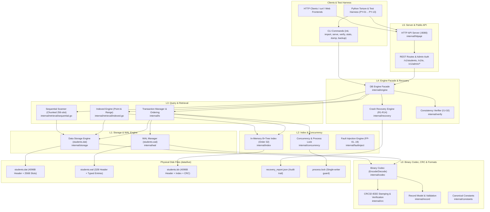
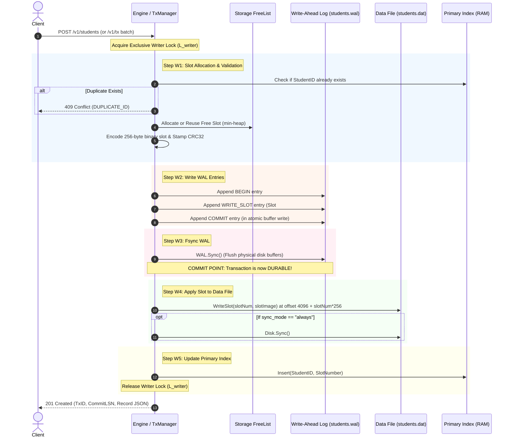
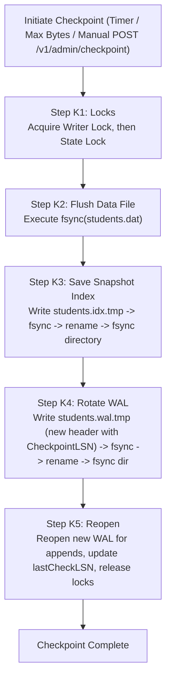
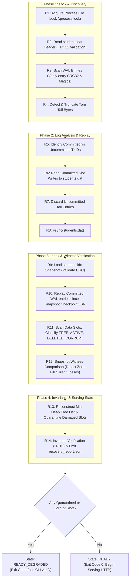
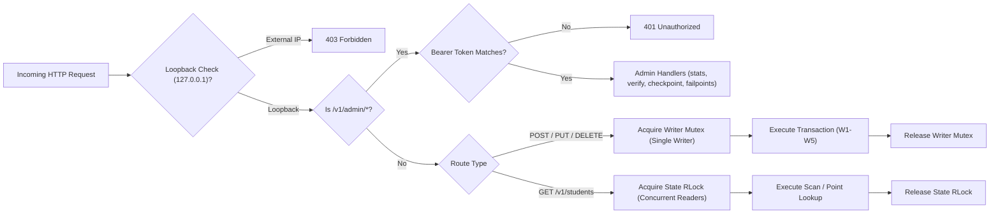
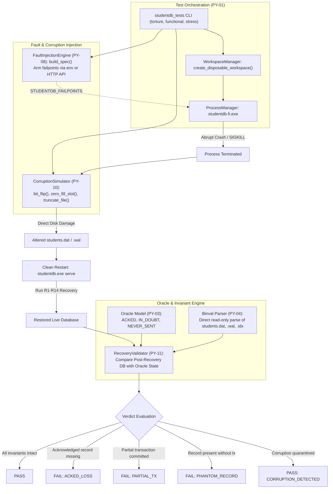

# BinStudentDB: End-to-End System Architecture & Visual Flow

This document provides a complete, granular, visual architectural breakdown of **BinStudentDB**—a high-reliability embedded student database system written in pure standard-library Go, paired with a deterministic crash-recovery and torture-testing framework in Python.

---

## 1. High-Level System Architecture

BinStudentDB is organized into clean, strictly downward-layered components (enforced by AST tests in [`cmd/studentdb/layer_test.go`](file:///c:/Users/pilar/Downloads/nexusfest/cmd/studentdb/layer_test.go)).



---

## 2. On-Disk Binary Storage Formats

All integer formats across all files are explicitly **little-endian** unsigned or signed integers.

### 2.1 `students.dat` (Slot Store)
The primary table is a fixed-slot heap file. The first 4,096 bytes form the header, followed by contiguous 256-byte slots grouped into 4,096-byte blocks (16 slots per block).

```
+---------------------------------------------------------------------------------------+
| File Header: 4096 Bytes                                                               |
| Magic: "STUDENT_DB\x00" (11B) | Ver: 1 (1B) | TotalSlots (4B) | FreeHead (4B)         |
| ActiveCount (4B) | FormatVer: 1 (2B) | Reserved (4066B) | Header CRC32 (4B)           |
+---------------------------------------------------------------------------------------+
| Slot 0 (256 Bytes)  | Slot 1 (256 Bytes)  | ... | Slot 15 (256 Bytes)                 | -> Block 0 (4KB)
+---------------------------------------------------------------------------------------+
| Slot 16 (256 Bytes) | Slot 17 (256 Bytes) | ... | Slot 31 (256 Bytes)                 | -> Block 1 (4KB)
+---------------------------------------------------------------------------------------+
```

#### Detailed 256-Byte Record Slot Layout:
Implemented in [`internal/codec/codec.go`](file:///c:/Users/pilar/Downloads/nexusfest/internal/codec/codec.go) and validated by [`internal/record/record.go`](file:///c:/Users/pilar/Downloads/nexusfest/internal/record/record.go):

| Byte Offset | Length | Field Name | Data Type | Specification / Padding Rules |
|---|---|---|---|---|
| `0 .. 3` | 4 B | `StudentID` | uint32 (LE) | Primary key (unique among active slots) |
| `4 .. 35` | 32 B | `FirstName` | UTF-8 String | ASCII/UTF-8, NUL-padded to 32 bytes |
| `36 .. 67` | 32 B | `LastName` | UTF-8 String | ASCII/UTF-8, NUL-padded to 32 bytes |
| `68 .. 71` | 4 B | `DateOfBirth` | int32 (LE) | Days since Unix epoch (1970-01-01) |
| `72` | 1 B | `Gender` | uint8 | `1` = Male, `2` = Female, `3` = Other |
| `73 .. 75` | 3 B | *Padding 1* | `[3]byte` | Reserved, strictly zero-filled (`0x00`) |
| `76 .. 139`| 64 B | `Email` | UTF-8 String | Validated email address, NUL-padded |
| `140 .. 159`| 20 B | `Phone` | ASCII String | Normalized E.164 (`+` and digits), NUL-padded |
| `160 .. 191`| 32 B | `Department` | UTF-8 String | Academic department name, NUL-padded |
| `192 .. 193`| 2 B | `EnrollmentYear`| uint16 (LE) | Range `[1900, 2100]` |
| `194 .. 195`| 2 B | *Padding 2* | `[2]byte` | Reserved, strictly zero-filled (`0x00`) |
| `196 .. 199`| 4 B | `GPA` | float32 (LE) | Single precision IEEE 754, range `0.00 .. 4.00` |
| `200 .. 207`| 8 B | `CreatedAt` | int64 (LE) | Unix timestamp in microseconds |
| `208 .. 215`| 8 B | `UpdatedAt` | int64 (LE) | Unix timestamp in microseconds |
| `216 .. 223`| 8 B | `TxID` | uint64 (LE) | Transaction ID that committed this slot |
| `224 .. 231`| 8 B | `CommitLSN` | uint64 (LE) | Log Sequence Number of the committing WAL entry |
| `232 .. 233`| 2 B | `Flags` | uint16 (LE) | Bit 0: `ACTIVE` (`0x0001`), Bit 1: `TOMBSTONE` (`0x0002`) |
| `234 .. 235`| 2 B | `RecordVersion` | uint16 (LE) | Canonical version = `1` |
| `236 .. 239`| 4 B | `NextFreeSlot` | uint32 (LE) | Singly-linked free slot pointer (`0xFFFFFFFF` = EOF) |
| `240 .. 251`| 12 B | *Reserved* | `[12]byte` | Future expansion, strictly zero-filled (`0x00`) |
| `252 .. 255`| 4 B | `Checksum` | uint32 (LE) | **CRC32-IEEE** over preceding 252 bytes `[0..251]` |

---

### 2.2 `students.wal` (Write-Ahead Log)
Implemented in [`internal/wal/wal.go`](file:///c:/Users/pilar/Downloads/nexusfest/internal/wal/wal.go). Guarantees durability before data modifications hit disk.

```
+---------------------------------------------------------------------------------------+
| WAL Header: 32 Bytes                                                                  |
| Magic: "STUDENT_WAL\x00" (12B) | FormatVer: 1 (2B) | CheckpointLSN (8B)               |
| NextTxID (8B) | Header CRC32 (2B)                                                     |
+---------------------------------------------------------------------------------------+
| Entry 1: BEGIN (36 Bytes)                                                             |
| Magic 0x57414C45 (4B) | Type: 1 (2B) | TxID (8B) | LSN (8B) | Length: 0 (4B)          |
| PrevLSN (8B) | Entry CRC32 (2B)                                                       |
+---------------------------------------------------------------------------------------+
| Entry 2: WRITE_SLOT (296 Bytes)                                                       |
| Magic 0x57414C45 (4B) | Type: 2 (2B) | TxID (8B) | LSN (8B) | Length: 260 (4B)        |
| SlotNumber (4B) | SlotImage (256B) | Entry CRC32 (2B)                                 |
+---------------------------------------------------------------------------------------+
| Entry 3: COMMIT (36 Bytes)                                                            |
| Magic 0x57414C45 (4B) | Type: 3 (2B) | TxID (8B) | LSN (8B) | Length: 0 (4B)          |
| PrevLSN (8B) | Entry CRC32 (2B)                                                       |
+---------------------------------------------------------------------------------------+
```

---

### 2.3 `students.idx` (B+Tree Primary Index Snapshot)
Implemented in [`internal/index/index.go`](file:///c:/Users/pilar/Downloads/nexusfest/internal/index/index.go). Holds an ordered in-memory B+Tree mapping `StudentID -> SlotNumber` and serializes atomic snapshots during checkpoints.

```
+---------------------------------------------------------------------------------------+
| Index Header: 4096 Bytes                                                              |
| Magic: "STUDENT_IDX\x00" (12B) | CheckpointLSN (8B) | SlotCount (8B) | EntryCount (4B)|
+---------------------------------------------------------------------------------------+
| Index Entries: EntryCount * 8 Bytes                                                   |
| Entry 0: StudentID (4B LE) + SlotNumber (4B LE)                                       |
| Entry 1: StudentID (4B LE) + SlotNumber (4B LE)                                       |
| ...                                                                                   |
+---------------------------------------------------------------------------------------+
| Trailer: 4 Bytes                                                                      |
| CRC32 over Header + All Entries (4B LE)                                               |
+---------------------------------------------------------------------------------------+
```

---

## 3. The 5-Step Transaction Write Ordering (W1–W5)

To guarantee the **Write Ordering Invariant (I8)** and durability, every write transaction (single insert, update, delete, or atomic batch) strictly follows steps **W1 through W5**:



---

## 4. The 5-Step Checkpoint Protocol (K1–K5)

Checkpoints truncate the WAL and persist an atomic index snapshot to disk, bounding recovery replay time:



---

## 5. The 14-Step Crash Recovery Algorithm (R1–R14)

On every engine startup (`studentdb serve`, `verify`, `recover`), crash recovery executes **steps R1 through R14** before any query or client request is served.



---

## 6. HTTP REST API & Concurrency Model

Implemented in [`internal/httpapi/server.go`](file:///c:/Users/pilar/Downloads/nexusfest/internal/httpapi/server.go).

### Loopback Enforcement & Security
- Server binds strictly to `127.0.0.1:<port>`. Attempts to bind to `0.0.0.0` or external network adapters are rejected at startup.
- Admin endpoints (`/v1/admin/*`) require a Bearer token matching `STUDENTDB_ADMIN_TOKEN`.
- Student records with PII (phone, email) are sanitized from logs.



---

## 7. Python Torture & Testing Framework Flow

The Python testing framework in [`python/studentdb_tests/`](file:///c:/Users/pilar/Downloads/nexusfest/python/studentdb_tests/) acts as an external adversary to mathematically prove crash safety and recovery correctness.



---

## 8. Summary of Failpoint Catalog (FP-01 to FP-19)

The engine embeds 19 deterministic failpoints across all critical I/O operations (enabled via `-tags faultinject` in [`internal/faultinject/failpoints.go`](file:///c:/Users/pilar/Downloads/nexusfest/internal/faultinject/failpoints.go)):

| Failpoint ID | Name | Trigger Location | Target Simulation |
|---|---|---|---|
| **FP-01** | `wal.append.before_write` | Before any bytes written to WAL | Pre-write crash (zero WAL trace) |
| **FP-02** | `wal.append.partial_write` | During WAL buffer write | Torn WAL entry (`partial:N`) |
| **FP-03** | `wal.append.after_write_before_sync` | After `write()` but before `fsync()` | Unflushed OS buffer lost on crash |
| **FP-04** | `wal.append.sync_fail_eio` | During `wal.Sync()` | Disk hardware error (`error:EIO`) |
| **FP-05** | `data.apply.before_slot_write` | Before writing slot in Step W4 | Redo recovery validation |
| **FP-06** | `data.apply.partial_slot_write` | During 256-byte slot write | Torn slot healed by WAL redo |
| **FP-07** | `data.extend.before_zeros` | Before extending `students.dat` | Growth boundary recovery |
| **FP-08** | `data.extend.partial` | While writing block padding zeros | Partial block extension recovery |
| **FP-09** | `data.extend.enospc` | During file allocation | Disk full handling (`error:ENOSPC`) |
| **FP-10** | `wal.extend.enospc` | During WAL allocation | WAL disk full handling |
| **FP-11** | `data.apply.after_write_before_sync` | After slot write before sync | Asynchronous dirty cache write |
| **FP-12** | `index.update.before_mem_insert` | Before inserting to B+Tree | Crash after data write, before index |
| **FP-13** | `checkpoint.before_data_sync` | Step K1 in checkpoint | Pre-checkpoint crash |
| **FP-14** | `checkpoint.before_index_write` | Step K2 in checkpoint | Index snapshot missing |
| **FP-15** | `checkpoint.before_index_rename` | Step K3 in checkpoint | Stale index snapshot recovery |
| **FP-16** | `checkpoint.before_wal_rotate` | Step K4 in checkpoint | Pre-WAL rotate recovery |
| **FP-17** | `checkpoint.before_wal_rename` | Step K4 rename | Torn WAL rename recovery |
| **FP-18** | `recovery.during_redo` | During recovery Step R6 | Crash-during-recovery recovery |
| **FP-19** | `recovery.during_index_rebuild` | During recovery Step R11 | Second-order recovery safety |

---

## 9. Quick Component Directory Reference

- **Entrypoint & CLI**: [`cmd/studentdb/main.go`](file:///c:/Users/pilar/Downloads/nexusfest/cmd/studentdb/main.go)
- **Engine Facade**: [`internal/engine/engine.go`](file:///c:/Users/pilar/Downloads/nexusfest/internal/engine/engine.go)
- **Transaction & Write Ordering**: [`internal/tx/tx.go`](file:///c:/Users/pilar/Downloads/nexusfest/internal/tx/tx.go)
- **Crash Recovery (R1–R14)**: [`internal/recovery/recovery.go`](file:///c:/Users/pilar/Downloads/nexusfest/internal/recovery/recovery.go)
- **Invariant Verification (I1–I10)**: [`internal/verify/verify.go`](file:///c:/Users/pilar/Downloads/nexusfest/internal/verify/verify.go)
- **Data File Storage**: [`internal/storage/storage.go`](file:///c:/Users/pilar/Downloads/nexusfest/internal/storage/storage.go)
- **Write-Ahead Log**: [`internal/wal/wal.go`](file:///c:/Users/pilar/Downloads/nexusfest/internal/wal/wal.go)
- **B+Tree Index**: [`internal/index/index.go`](file:///c:/Users/pilar/Downloads/nexusfest/internal/index/index.go)
- **Binary Codec**: [`internal/codec/codec.go`](file:///c:/Users/pilar/Downloads/nexusfest/internal/codec/codec.go)
- **CRC32 Engine**: [`internal/crc/crc.go`](file:///c:/Users/pilar/Downloads/nexusfest/internal/crc/crc.go)
- **HTTP REST Server**: [`internal/httpapi/server.go`](file:///c:/Users/pilar/Downloads/nexusfest/internal/httpapi/server.go)
- **Torture Suite Runner**: [`python/studentdb_tests/torture/torture.py`](file:///c:/Users/pilar/Downloads/nexusfest/python/studentdb_tests/torture/torture.py)
