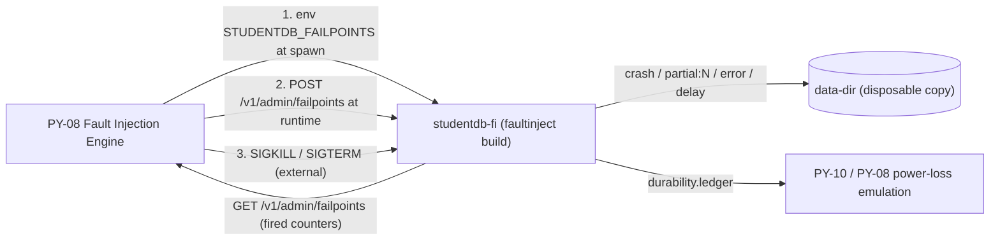
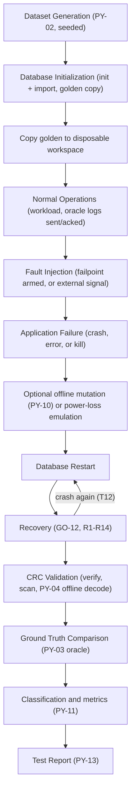

# TORTURE.md — Database Torture-Testing Architecture and Strategy

| Field | Value |
|---|---|
| Document version | 1.0 (design only; nothing has been executed) |
| Derives from | [ARCHITECTURE.md](ARCHITECTURE.md) — failure handling §F, §G; Python architecture §H; failpoint catalog §H.4 |
| Related | [TEST.md](TEST.md) (test IDs, acceptance criteria), [PROMPTS.md](PROMPTS.md) (P19–P22, P26), [README.md](README.md) (how to run) |

> **Principle.** Torture testing intentionally causes controlled failures and asks one question: *did the database preserve integrity, and did it tell the truth about what it could not preserve?*
> **CRC alone is not crash recovery.** CRC32 (GO-05) *detects* accidental corruption. Crash consistency comes from the WAL (GO-11) and the Recovery Manager (GO-12). Passing a CRC check after a crash proves nothing about lost or partial transactions; the oracle comparison does.

---

# A. Torture Testing Objectives

| Objective | Question answered | Primary evidence |
|---|---|---|
| Database reliability | Does the engine stay correct (no panic, hang, or wrong answer) under hostile conditions? | No `HANG`/`PANIC`; all verdicts in §E pass. |
| Storage integrity | Are records on disk exactly what was committed? | PY-04 offline decode + oracle. |
| Retrieval reliability | Do both retrieval paths return only valid data? | Sequential vs indexed result equivalence; CRC verified. |
| Crash resistance | Do acknowledged commits survive abrupt termination? | `ACKED_LOSS = 0`. |
| Recovery correctness | Is the recovered state atomic, consistent, and honestly reported? | `recovery_report.json` + `GET /v1/admin/verify` + oracle. |

---

# B. Failure Scenarios

Scenario IDs `T01–T15` are the canonical identifiers used in [TEST.md](TEST.md) (prefix `TT`) and [PROMPTS.md](PROMPTS.md).

## B.1 Scenario Catalogue

| ID | Scenario | Injection (engine → mechanism) | Expected outcome class (§F.3) |
|---|---|---|---|
| T01 | Abrupt termination during **insertion** | PY-08: FP-01…FP-05, FP-07, FP-08 + random SIGKILL during insert workload | Expected rollback **or** committed recovery (per §B.2 matrix) |
| T02 | Abrupt termination during **updates** | Same failpoints; update workload | Same |
| T03 | Abrupt termination during **deletion** | Same failpoints; delete workload (tombstones) | Same |
| T04 | **Interrupted binary writes** | FP-06 (`partial:N`, torn slot), FP-08 (partial growth), FP-02 (torn WAL entry) | Committed recovery (torn slot repaired by redo) / expected rollback (torn WAL) |
| T05 | **Corrupted binary records** | PY-10: bit flip, byte overwrite, burst ≤32 bits, zero-fill slot, slot swap on disposable copy | Corruption detected (slot quarantined) or redo-healed; zero-fill → witness detection |
| T06 | **Corrupted CRC values** | PY-10: flip bits in `[252,256)` of slots; header CRC; WAL entry CRC; idx trailer CRC | Corruption detected; no wrong data served |
| T07 | **Truncated database files** | PY-10: truncate `.dat` (mid-slot, block boundary, below header), `.wal` (mid-entry, at entry boundary, inside header), `.idx` | Detected/loss-flagged, torn-tail handled, or FATAL for header damage |
| T08 | **Corrupted index files** | PY-10: bit flips, stale snapshot, wrong CheckpointLSN, tampered entries (CRC recomputed), truncated, deleted | Snapshot discarded/flagged; index rebuilt from scan; data intact |
| T09 | **Interrupted WAL writes** | FP-02, FP-03; PY-10: tail garbage, missing COMMIT, mid-log corruption, WAL deleted | Torn tail truncated; mid-log ⇒ FATAL `WAL_MIDLOG_CORRUPTION`; WAL missing ⇒ `WAL_MISSING` reported |
| T10 | **Disk-full simulation** | FP-10, FP-11, FP-12 (`error:ENOSPC`); optional Linux tmpfs quota (§C.6) | Definite failure (no effect) or in-doubt resolved; engine → `FAILED_READONLY`; recovers after space restored |
| T11 | **Concurrent read/write** | PY-07 workload (N readers, M writers) + FP / SIGKILL | No partial tx visible; atomicity after kill |
| T12 | **Repeated restarts** | Loops of graceful restarts, SIGKILL restarts, crash-during-recovery (FP-18, FP-19) | Idempotent recovery; identical final state |
| T13 | **Invalid record offsets** | PY-10: index entries to out-of-range / FREE / other-ID slots; WRITE_SLOT slot number beyond `SlotCount+1,024` | No wrong record served (`INDEX_INCONSISTENT`); no unbounded allocation; no crash |
| T14 | **Unexpected application termination** | SIGKILL at random times; SIGTERM mid-workload; failpoint `crash` | Per §B.2; SIGTERM ⇒ clean checkpoint, zero data loss |
| T15 | **Recovery after incomplete transactions** | Multi-op batches (2–1,000 ops) crashed at every FP-01…FP-08 | All-or-nothing; no partial batch visible |

## B.2 Failpoint Expectation Matrix (deterministic oracle rules)

The torture engine uses this table to decide what the post-recovery state **must** be for the transaction in flight. "Process kill" keeps OS-cached bytes; "power-loss emulation" (§C.7) removes unsynced WAL tail bytes.

| Failpoint | In-flight tx after **process kill** | In-flight tx after **power-loss emulation** |
|---|---|---|
| FP-01 `wal.append.before_write` | MUST be absent | MUST be absent |
| FP-02 `wal.append.partial_write` | MUST be absent (incomplete ⇒ rolled back) | MUST be absent |
| FP-03 `wal.append.after_write_before_sync` | present **or** absent (in doubt), atomic | MUST be absent (tail beyond ledger removed) |
| FP-04 `wal.commit.after_sync` | MUST be present (redo) | MUST be present |
| FP-05/06/07 (during apply) | MUST be present (redo repairs torn/partial apply) | MUST be present |
| FP-08 `data.extend.partial` | MUST be present | MUST be present |
| FP-09 `data.sync.error` (checkpoint) | all acknowledged present; engine `FAILED_READONLY` until restart | same |
| FP-10 `disk.enospc.wal` | client receives `507 DISK_FULL` ⇒ MUST be absent | same |
| FP-11 `disk.enospc.data` | commit durable ⇒ client receives `503 ENGINE_FAILED_READONLY` (in doubt); after restart MUST be present | same |
| FP-12 `disk.enospc.checkpoint` | checkpoint fails; all acknowledged present after restart | same |
| FP-13…FP-17 (checkpoint steps) | no tx in flight; all acknowledged present; state identical | same |
| FP-18/19 (recovery) | final state identical to an uninterrupted recovery | same |

External SIGKILL at a random instant has no fixed failpoint: the oracle treats the in-flight transaction as **IN_DOUBT** (present-or-absent, atomically).

## B.3 Scenario Detail

| ID | Workload & steps | Pass criteria (all must hold) |
|---|---|---|
| T01–T03 | Golden copy → N acknowledged ops (insert / update / delete respectively) → arm failpoint → issue the in-flight op → crash → restart → validate | §E checks pass; matrix rule satisfied; for T03, deleted IDs absent and slot reusable (next insert succeeds). |
| T04 | Same as T01 with `partial:N`: N∈{1, 127, 128, 255} for slots; N∈{1, 35, 36, 295} around entry boundaries (BEGIN 36 B, WRITE_SLOT 296 B) | Torn slot repaired by redo (`tx_committed_redone ≥ 1`); torn WAL entry ⇒ `torn_tail_bytes > 0`, tx absent. |
| T05 | Stop DB cleanly (checkpointed). Choose *k* ACTIVE slots (seeded). Apply mutation inside CRC-covered bytes. Start DB. | Every damaged slot appears in `slots_corrupt[]` (rate 100%); state `READY_DEGRADED`; all other records intact; scan `errors[]` lists the same slots. **Zero-fill variant:** not CRC-detectable; MUST appear in `suspected_data_loss[]` via the snapshot witness (§ARCH G.6). **Healed variant:** kill before checkpoint so the WAL still holds the image ⇒ redo repairs; `slots_corrupt` empty. |
| T06 | Corrupt only CRC fields (record / header / WAL entry / idx trailer) | Record CRC: quarantined. Header CRC: FATAL exit 3. WAL entry CRC: tail ⇒ torn tail; mid-log ⇒ FATAL. Idx CRC: snapshot discarded, `index_source=scan`. |
| T07 | Truncation points: `.dat` at `4096 + (k×4096) + {0, 100, 255}`; `.dat` at 2048; `.wal` at each entry boundary and ±1 byte; `.wal` at 16; `.idx` at several offsets | `.dat` mid-slot: padded, lost slots in `suspected_data_loss[]`. `.dat` < 4096: FATAL. `.wal` at entry boundary: all earlier committed tx recovered. `.wal` mid-entry: torn tail. `.wal` < 32: FATAL. `.idx`: discarded + rebuilt. |
| T08 | Variants: random bit flips; valid-CRC snapshot with wrong slots (CRC recomputed by PY-10); LSN mismatch; deleted file | Data records unaffected; report flags mismatch/`index_source=scan`; with `startup_verify=fast` a tampered valid-CRC snapshot MUST NOT cause a wrong record to be returned (ID cross-check ⇒ `INDEX_INCONSISTENT`). |
| T09 | Tail garbage appended; COMMIT entry removed; random byte flipped inside an early committed entry followed by valid entries; WAL deleted | Tail garbage/missing COMMIT ⇒ rolled back. Mid-log damage ⇒ FATAL (exit 3), WAL preserved byte-identical. WAL missing ⇒ `WAL_MISSING` in report; checkpointed data intact. |
| T10 | Arm FP-10/11/12 after K acknowledged ops; continue issuing ops; then restart a **fresh process** (failpoints not armed) | Rejected ops return documented errors; engine `FAILED_READONLY` (reads still work); after restart: acknowledged data intact, in-doubt resolved per matrix, `verify` ok. |
| T11 | 8 readers + 4 writers; writers use batches of 2–50 ops; readers continuously scan + point-read; kill at random moment | No reader ever observes part of a batch; post-recovery atomicity per batch; no duplicate/missing IDs vs oracle. |
| T12 | (a) 100 × graceful restart; (b) 100 × SIGKILL-restart on idle DB; (c) crash at FP-18 then FP-19 then FP-18 … then allow success; (d) restart loop during workload | State after every restart equals the expected state; `recovery_report` counts stabilize; no growth of WAL or `.dat` across idle restarts. |
| T13 | Index entries ⇒ slot ≥ `SlotCount`; ⇒ FREE slot; ⇒ other ID; crafted WAL entry (valid CRC) with slot `SlotCount+10,000` | Never a wrong record; `INDEX_INCONSISTENT` or finding; crafted WAL entry rejected (torn-tail discard or FATAL), file never extended beyond the bound; no panic. |
| T14 | SIGKILL at uniform random delays 0–2,000 ms during mixed workload; SIGTERM variant | SIGKILL ⇒ §E all pass; SIGTERM ⇒ exit 0, WAL header-only on next start (`tx_committed_redone = 0`). |
| T15 | Batches of 2, 10, 100, 1,000 ops, each crashed at FP-01…FP-08 | For every batch: either **all** ops visible or **none**; matrix rule; `PARTIAL_TX = 0`. |

---

# C. Fault Injection Architecture

## C.1 How Python Communicates with the Go Application

Interface contract: [ARCHITECTURE.md §B.4 and §H.4](ARCHITECTURE.md). Failpoints exist **only** in `-tags faultinject` builds; PY-01 refuses to run torture against a `production` build (`GET /v1/admin/capabilities`).

## C.2 Failure Injection Points
The catalog FP-01…FP-19 in [ARCHITECTURE.md §H.4](ARCHITECTURE.md) is normative. Groupings: **WAL path** (FP-01…FP-04, FP-10), **apply path** (FP-05…FP-08, FP-11), **sync** (FP-09), **checkpoint** (FP-12…FP-17), **recovery** (FP-18, FP-19). Python-side injection points (no failpoint needed): external signals, offline file mutation (PY-10), power-loss emulation.

## C.3 Failure Probability
Each armed failpoint accepts:
| Parameter | Meaning |
|---|---|
| `after_hits=N` | Fire on the N-th time execution reaches the point (deterministic). |
| `probability=p` | Fire with probability *p* per hit, using the failpoint's own seeded RNG. |
| `seed` | Seed for the failpoint RNG. |
| `once=true` | Fire at most once (default for `crash`). |

Default mix: *deterministic sweep* (`after_hits` ∈ {1, 2, 3, 5, 10, 50, 200}) plus *random* mode (`probability` ∈ {0.001, 0.01, 0.05}).

## C.4 Randomized Failure Testing
Per iteration PY-09 draws from the iteration seed: scenario variant, workload mix (insert/update/delete/read ratios), batch sizes, failpoint choice and parameters, SIGKILL delay, mutation offsets. Draw order is fixed so adding a scenario does not perturb other scenarios' seeds (`iteration_seed = SHA256(master_seed ‖ scenario_id ‖ iteration)`).

## C.5 Deterministic Reproduction
Every iteration writes `repro.json` containing: master seed, scenario ID, iteration, iteration seed, failpoint spec, operation log (op, ID, payload hash, sent/acked flags, response code), mutation manifest, binary SHA-256 (`studentdb-fi`), golden-dataset SHA-256, Python/Go versions. `python -m studentdb_tests torture --replay repro.json` (illustrative) re-executes against a fresh copy. **Limit:** failpoint-driven crashes replay exactly; external SIGKILL timing is reproduced by replaying the *same op sequence with a failpoint at the recorded hit count* (the engine records the hit count at kill time via the ledger), not by wall-clock timing.

## C.6 Test Isolation and Disposable Copies
- Golden datasets in `data/golden/<count>/` are read-only and hash-verified before and after every run.
- Each iteration copies golden → `data/work/<run_id>/<iteration>/db/`; the copy is the **only** location any engine, simulator, or truncation may touch (path guard in PY-01 and PY-10).
- One server process per workspace; ports are ephemeral; no shared state between iterations.
- Passing iterations are deleted; failing iterations are retained with their `repro.json`.
- **Disk-full realism (optional, Linux):** a size-limited tmpfs/loopback mount can be used as a second ENOSPC mechanism; failpoint-based ENOSPC remains the default and is portable. Mount setup requires privileges and is documented as manual in [README.md](README.md).

## C.7 Limitations (stated honestly)
1. **Process kill is not power loss.** After SIGKILL, bytes already `write()`n survive in the OS page cache even if never fsynced. Power loss is only **emulated**: PY-08 truncates WAL bytes beyond the last fsynced length recorded in `durability.ledger`.
2. **Unsynced in-place data-file overwrites are not emulated** (reverting to old bytes would require the old contents). They are covered indirectly by torn-slot failpoints (FP-06) and by the WAL redo design (data-file writes are never trusted until checkpoint).
3. Lying storage (fsync acknowledged but not durable) cannot be simulated or defended against.
4. Filesystem metadata reordering (rename/dir-entry loss) is not emulated; the design relies on fsync of the directory after renames (K3/K4 in ARCHITECTURE §F.6).

---

# D. Torture Testing Workflow

## D.1 Workflow

## D.2 Per-Iteration Algorithm (prose)
1. Derive iteration seed; verify golden SHA-256; copy golden to the workspace.
2. Start `studentdb-fi` (`serve`), wait for the ready line; record the initial oracle (all golden records **ACKED**).
3. Run the seeded workload; for each op record `sent` before sending and `acked` on a `2xx` response; responses `507 DISK_FULL` from FP-10 mark the op **definitely failed**; connection loss or `503` after send marks it **IN_DOUBT**.
4. Trigger the failure (failpoint fires, or PY-08 sends a signal at the drawn delay).
5. Confirm the process is gone (or, for ENOSPC, still running in `FAILED_READONLY`; then stop it with SIGKILL).
6. Apply post-crash mutation (T05–T09, T13) or power-loss emulation, if the scenario calls for it.
7. Restart; wait for ready (or for exit code 3/4 when FATAL is expected); read `recovery_report.json`.
8. Run all §E checks; for crash-during-recovery scenarios repeat steps 6–7 as scripted.
9. Compare to the oracle and the expectation matrix (§B.2); classify (§F.3); emit `results.jsonl` row; clean up or retain.

## D.3 Profiles (targets, not results)
| Profile | Datasets | Iterations per scenario | Purpose |
|---|---|---|---|
| `smoke` | 1,000 | 50 | Fast gate; every scenario at least once with several variants |
| `standard` | 1,000 + 10,000 | 500 | Regular qualification |
| `soak` | 1,000 + 10,000 + 100,000 | 5,000 (or time-boxed) | Long-run stability, rare interleavings |

---

# E. Data Integrity Validation

All checks run after **every** iteration, in this order.

| # | Check | Method | Failure verdict |
|---|---|---|---|
| E1 | Recovery report sane | Parse `recovery_report.json`; required fields; `fatal` null unless expected | `RECOVERY_FAILED` |
| E2 | Consistency invariants | `GET /v1/admin/verify`; `invariants{I1..I10}` | `INVARIANT_VIOLATION` |
| E3 | Missing records | Oracle ACKED IDs ∖ actual IDs | `ACKED_LOSS` (or `DETECTED_LOSS` if listed in `suspected_data_loss[]`/`slots_corrupt[]` and scenario is a corruption scenario) |
| E4 | Duplicate records | Same ID twice in scan; I4 | `DUPLICATE_RECORD` |
| E5 | Unexpected modifications | Field-by-field compare vs oracle (user fields); timestamps checked for plausibility only | `UNEXPECTED_MODIFICATION` |
| E6 | Phantom records | Actual IDs ∖ (ACKED ∪ IN_DOUBT) | `PHANTOM_RECORD` |
| E7 | Corrupted records | PY-04 offline CRC scan of stopped files; `slots_corrupt` vs actual | `SILENT_CORRUPTION` if PY-04 finds a bad slot the engine did not report |
| E8 | Invalid CRC detection | Compare PY-10 damage manifest with `slots_corrupt[]`/`suspected_data_loss[]` | `UNDETECTED_CORRUPTION` |
| E9 | Inconsistent indexes | Sequential scan result set == indexed range scan `[1, max]` set; PY-04 `.idx` vs `.dat` | `INDEX_MISMATCH` |
| E10 | Incomplete transactions | For each multi-op tx: ops either all visible or all invisible | `PARTIAL_TX` |
| E11 | In-doubt resolution | Each IN_DOUBT tx resolved atomically; matrix (§B.2) satisfied | `MATRIX_VIOLATION` |
| E12 | Liveness | Post-recovery insert + read + delete succeeds (unless `FAILED_READONLY` expected) | `POST_RECOVERY_FAILURE` |
| E13 | Idempotence | Second restart without workload leaves state and recovery counts unchanged | `NON_IDEMPOTENT_RECOVERY` |
| E14 | Stability | No panic text in logs; process responsive within timeout | `PANIC` / `HANG` |

Every iteration yields exactly one **verdict**: `PASS` or one or more failure verdicts above (any failure verdict fails the iteration).

---

# F. Recovery Evaluation

## F.1 Metrics
| Metric | Definition |
|---|---|
| Recovery success rate | `iterations with verdict PASS ÷ triggered iterations` (per scenario and overall). Iterations where the failpoint never fired (`NOT_TRIGGERED`) are excluded and counted separately. |
| Data integrity percentage | `ACKED records present and field-identical ÷ ACKED records` × 100, per iteration and aggregated (excluding records intentionally destroyed in corruption scenarios, which are scored by detection rate). |
| Recovery time | `process start → ready line` in ms (from `recovery_report.duration_ms` cross-checked by PY-12 wall-clock). Reported p50/p95/max per dataset size. |
| Corruption detection rate | `injected corruptions reported (slots_corrupt ∪ suspected_data_loss ∪ expected FATAL) ÷ injected corruptions`. Target 100%. |
| Failed transaction count | Client-visible failures: definite (`507`, `4xx`) + in-doubt, per scenario. |
| Data loss measurement | `ACKED_LOSS` count (**must be 0** in recoverable scenarios); `DETECTED_LOSS` count (expected only for unrecoverable-corruption scenarios); records lost per iteration. |

## F.2 Reporting Dimensions
Per scenario × dataset size × failpoint: iterations, triggered, PASS, failure verdicts by type, recovery-time percentiles, redo counts (`tx_committed_redone`), discarded counts (`uncommitted_discarded`), torn-tail bytes.

## F.3 Outcome Classes (must be kept distinct)
| Class | Meaning | Example | Counts as |
|---|---|---|---|
| **EXPECTED_ROLLBACK** | A transaction was never committed (incomplete in WAL or never logged) and is correctly absent. | FP-01, FP-02, torn WAL tail | Success. Not data loss. |
| **COMMITTED_RECOVERED** | A durably committed transaction was missing from the data file at restart and was restored by WAL redo. | FP-04, FP-06 | Success; evidences WAL value. |
| **IN_DOUBT_RESOLVED** | Client never received the ack; either outcome is legal but must be atomic. | SIGKILL mid-commit, FP-03 (process kill) | Success if atomic. |
| **CORRUPTION_DETECTED** | Physical damage detected, quarantined, and reported; other data intact. | T05, T06 | Success (detection). The affected record's loss is **expected and accounted**. |
| **UNRECOVERABLE_PHYSICAL_CORRUPTION** | Damage to already-checkpointed data with no WAL image. The system cannot repair it; it must detect and report it. | Bit flip in a checkpointed slot; truncated `.dat` | Success **only if detected**; reported as `DETECTED_LOSS`, never as pass-with-silent-loss. Remedy = backup restore. |
| **FATAL_EXPECTED** | Structural corruption that must stop startup. | Header CRC damage; mid-log WAL corruption | Success if exit code 3 and files left untouched. |

Failure classes (always fail): `ACKED_LOSS`, `SILENT_CORRUPTION`, `UNDETECTED_CORRUPTION`, `PARTIAL_TX`, `PHANTOM_RECORD`, `DUPLICATE_RECORD`, `INDEX_MISMATCH`, `UNEXPECTED_MODIFICATION`, `MATRIX_VIOLATION`, `RECOVERY_FAILED`, `NON_IDEMPOTENT_RECOVERY`, `POST_RECOVERY_FAILURE`, `INVARIANT_VIOLATION`, `PANIC`, `HANG`.

**Rule:** a database that restarts without error has *not* thereby recovered. Success requires E1–E14.

---

# G. Torture Test Safety

## G.1 Hard Rules
1. **All destructive testing uses disposable copies.** No engine, simulator, or truncation touches `data/golden/` or `data/live/`.
2. PY-01 and PY-10 resolve every target path and refuse anything not under `data/work/<run_id>/`.
3. The golden directory is `chmod 0444/0555`; its SHA-256 manifest is verified before and after each run; any change aborts the whole run with a non-zero exit.
4. The runner refuses to start if the target binary reports `build: "production"`.
5. Torture tooling never deletes outside its own `data/work/<run_id>/` tree.
6. Reports never include record field values beyond synthetic dataset IDs.

## G.2 Backup Procedure (golden dataset and any live database)
1. Stop the server (SIGTERM) so the engine checkpoints and exits 0.
2. `studentdb verify --data-dir <dir>` must exit 0 (illustrative command).
3. Copy `students.dat`, `students.idx`, `students.wal` to `data/golden/<count>/` (or the backup destination), or use `studentdb backup`.
4. Generate `manifest.json` with SHA-256 for each file, the dataset seed/count, binary and format versions.
5. Set files read-only.
6. Run `verify` on the **copy** and confirm it passes.

## G.3 Restoration Procedure
1. Stop any running server for the target directory.
2. Move the damaged directory aside (never delete it before analysis).
3. Create an empty directory (mode `0700`) and copy the three files from the verified backup.
4. Compare SHA-256 values against `manifest.json`.
5. Run `studentdb verify`; start the server; confirm `READY` and the expected record count.
6. For torture runs, restoration is automatic: delete the workspace, copy golden again.

## G.4 What This Suite Does Not Claim
- It does not claim CRC32 provides recovery, repair, or tamper resistance (see [ARCHITECTURE.md §D.7](ARCHITECTURE.md)).
- It does not claim protection against lying storage, or full power-loss fidelity (§C.7).
- No pass rates are stated in this document; all numbers above are **targets or definitions**. Actual results appear only in generated reports ([TEST.md](TEST.md) §F).
