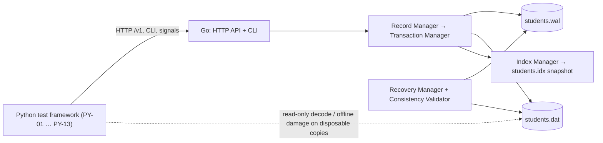

# BinStudentDB

**A Go binary student database with CRC32 integrity checking, WAL-based crash recovery, and a Python torture-testing framework.**

> ## Project status: design complete, implementation not started
> This repository currently contains **documentation only**. Every command, flag, file, endpoint, and path below describes the *intended* system and is **illustrative**. Nothing has been built or executed, and no test results exist.
>
> **Command legend used in this file**
> | Marker | Meaning |
> |---|---|
> | 🟦 **Illustrative** | Planned command; does not exist yet. Shown to explain the intended workflow. |
> | ✅ **Implemented** | Reserved for the future, once the command exists and is covered by tests. **No command is marked implemented today.** |
> | ⚙️ **Standard tool** | A real, existing third-party command (Go, Python, git) used for setup. |
>
> Authoritative design: [ARCHITECTURE.md](ARCHITECTURE.md). Torture design: [TORTURE.md](TORTURE.md). Development prompts: [PROMPTS.md](PROMPTS.md). Test plan: [TEST.md](TEST.md).

---

## 1. Project Title
**BinStudentDB — Go Binary Student Database with Python Torture Testing**

## 2. Project Introduction
BinStudentDB stores student records in a fixed-layout **binary file on a physical disk**. Every record carries a **CRC32** checksum. A **Write-Ahead Log (WAL)** makes updates atomic and durable across crashes. The engine is written in **Go**; a separate **Python** framework generates data, stress-tests, injects faults, corrupts files, kills the process, and checks recovery against an independent ground truth.

## 3. Problem Statement
About 1,000 student records must live on disk in binary form and be retrieved reliably and quickly. We must **prove**, not assume, that the store detects corruption, survives abrupt termination without losing acknowledged writes, and can grow beyond 1,000 records. A successful restart is never treated as proof of successful recovery.

## 4. Project Objectives
1. Durable binary storage with fixed 256-byte record slots.
2. CRC32 corruption detection on every record.
3. Atomic, durable transactions through a redo-only WAL.
4. Automatic crash recovery with a structured report.
5. Sequential and indexed retrieval with measured latency.
6. Safe in-process concurrency (many readers, one writer).
7. Reproducible, isolated fault-injection and torture testing.
8. Format that scales from 1,000 to 100,000+ records unchanged.

## 5. Features
| Area | Feature | Spec |
|---|---|---|
| Storage | Header + 4 KiB blocks of 16 × 256-byte slots | [ARCH §C](ARCHITECTURE.md) |
| Integrity | CRC32-IEEE on records, headers, WAL entries, index | [ARCH §D](ARCHITECTURE.md) |
| Operations | Create, read, update, delete, atomic batches (≤ 1,000 ops) | [ARCH §E](ARCHITECTURE.md) |
| Retrieval | Sequential scan with filters; indexed point/range | [ARCH §E.3–E.4](ARCHITECTURE.md) |
| Durability | WAL, checkpoints, `fsync` ordering | [ARCH §F](ARCHITECTURE.md) |
| Recovery | 14-step startup recovery, quarantine, loss detection, JSON report | [ARCH §G](ARCHITECTURE.md) |
| Validation | Invariants I1–I10, online and offline | [ARCH §G.7](ARCHITECTURE.md) |
| Interfaces | HTTP API v1 (loopback) and CLI | [ARCH §E.9–E.10](ARCHITECTURE.md) |
| Testing | Python: datasets, functional, stress, concurrency, fault injection, torture, corruption, recovery validation, benchmarks, reports | [ARCH §H](ARCHITECTURE.md), [TEST.md](TEST.md) |

## 6. Technology Stack
| Layer | Technology |
|---|---|
| Database engine | Go ≥ 1.22, standard library only, no cgo |
| Test framework | Python ≥ 3.11 with `pytest`, `pytest-timeout`, `requests`, `psutil`, `jinja2` |
| Interface | HTTP/JSON on loopback, CLI, POSIX signals |
| Diagrams | Mermaid (rendered by GitHub and most Markdown viewers) |
| Platforms | Linux (primary), macOS (secondary); Windows unsupported in v1 |

## 7. Architecture Overview



**Write rule (simplified):** log the whole transaction to the WAL → `fsync` (commit point) → apply slot images to the data file → update the index → acknowledge. At checkpoint the data file is `fsync`ed, an index snapshot is written, and the WAL is rotated. On every start, recovery replays committed transactions, discards incomplete ones, verifies every slot's CRC, rebuilds the index, and reports exactly what it found. **CRC detects damage; the WAL and recovery repair crashes; backups are the remedy for physical corruption of checkpointed data.**

## 8. System Requirements
| Item | Minimum |
|---|---|
| OS | Linux or macOS |
| CPU / RAM | 2 cores / 2 GB (100k-record torture runs: 4 cores / 4 GB recommended) |
| Disk | Local SSD/NVMe with honest `fsync`; ≥ 2 GB free for torture workspaces |
| Go | ≥ 1.22 |
| Python | ≥ 3.11 |
| Not supported | Network file systems, Windows (v1) |

## 9. Go Installation
⚙️ **Standard tool commands**
```bash
# Download from https://go.dev/dl/ and install, then verify:
go version          # expect go1.22 or newer
```

## 10. Python Installation
⚙️ **Standard tool commands**
```bash
python3 --version                  # expect 3.11 or newer
python3 -m venv .venv
source .venv/bin/activate
pip install -r python/requirements.txt   # 🟦 file is planned; see ARCH §H.2 for its contents
```

## 11. Project Setup
```bash
git clone <your-repo-url> studentdb && cd studentdb     # ⚙️
# 🟦 Illustrative builds (see ARCH §K.2):
go build -o bin/studentdb ./cmd/studentdb                           # production build
go build -tags faultinject -o bin/studentdb-fi ./cmd/studentdb      # fault-injection build (torture only)
go build -race -o bin/studentdb-race ./cmd/studentdb                # race-detector build
```
**Never** use `studentdb-fi` in production: it contains failpoints and test endpoints. The torture runner refuses a production binary, and production builds contain no failpoint code.

## 12. Directory Structure
```
studentdb/
├── cmd/studentdb/               # CLI entry point (GO-16)
├── internal/                    # crc, record, codec, storage, wal, index, tx, concurrency,
│                                # retrieval, engine, recovery, verify, httpapi, faultinject
├── python/studentdb_tests/      # PY-01 … PY-13
├── bin/                         # built binaries
├── data/
│   ├── golden/<count>/          # read-only datasets (never modified by tests)
│   ├── live/                    # normal runtime database
│   └── work/<run_id>/<iter>/db/ # disposable torture copies
├── reports/<run_id>/            # generated reports
└── ARCHITECTURE.md  TORTURE.md  PROMPTS.md  TEST.md  README.md
```
Database directory contents: `students.dat`, `students.idx`, `students.wal`, `students.lock`, `recovery_report.json` (and `durability.ledger` in fault-injection builds). Details: [ARCH §C.1](ARCHITECTURE.md).

## 13. Database Initialization
🟦 **Illustrative**
```bash
bin/studentdb init --data-dir data/live
```
Creates the immutable 4096-byte header, an empty WAL, an empty index snapshot, and the lock file (mode `0700`/`0600`).

## 14. Dataset Generation
🟦 **Illustrative**
```bash
python -m studentdb_tests gen --count 1000   --seed 42 --out data/golden/1000
python -m studentdb_tests gen --count 10000  --seed 42 --out data/golden/10000
python -m studentdb_tests gen --count 100000 --seed 42 --out data/golden/100000
```
Produces `students.csv`, `manifest.json` (seed, count, SHA-256), and a read-only golden database built with `init` + `import` + `checkpoint`. Same seed ⇒ identical output. To load an existing real dataset instead, convert it to the documented CSV columns and use `studentdb import` (below). Use synthetic data for tests: records contain personal data.

## 15. Application Execution
🟦 **Illustrative**
```bash
export STUDENTDB_ADMIN_TOKEN=change-me          # optional; protects /v1/admin/*
bin/studentdb serve --data-dir data/live --addr 127.0.0.1:8080
```
Startup runs recovery first, then prints one JSON line (`{"event":"ready",…}`) and opens the loopback listener. Useful flags: `--sync-mode always|none` (`none` is **unsafe**, benchmarks only), `--startup-verify full|fast`, `--on-corruption quarantine|fail`, `--wal-max-bytes`. Stop gracefully with SIGTERM (checkpoint, exit 0). Exit codes: 0 ok, 1 usage, 2 verify failed, 3 recovery fatal, 4 directory locked.

## 16. Student Record Operations
🟦 **Illustrative** HTTP examples (full contract: [ARCH §E.9](ARCHITECTURE.md))
```bash
# Create
curl -X POST localhost:8080/v1/students -H 'Content-Type: application/json' -d '{
  "student_id": 20240001, "first_name": "Asha", "last_name": "Rao",
  "date_of_birth": "2004-05-17", "gender": "female", "email": "asha.rao@example.com",
  "phone": "+91-9000000000", "department": "Computer Science",
  "enrollment_year": 2022, "gpa": 3.75 }'
# Read / update / delete
curl localhost:8080/v1/students/20240001
curl -X PUT    localhost:8080/v1/students/20240001 -H 'Content-Type: application/json' -d '{…full record…}'
curl -X DELETE localhost:8080/v1/students/20240001
# Atomic batch (all-or-nothing)
curl -X POST localhost:8080/v1/tx -H 'Content-Type: application/json' \
  -d '{"ops":[{"op":"insert","student":{…}},{"op":"delete","student_id":20240001}]}'
```
Responses on writes include `tx_id` and `commit_lsn`. Validation rules: [ARCH §I.2](ARCHITECTURE.md). Offline import of an existing dataset (server stopped): `bin/studentdb import --data-dir data/live --input students.csv`.

## 17. CRC Verification
🟦 **Illustrative**
```bash
bin/studentdb verify --data-dir data/live            # offline, server stopped; exit 2 on failure
curl localhost:8080/v1/admin/verify                  # online (invariants I3–I7, I9, I10)
```
Every read verifies the slot CRC. A CRC mismatch is reported, never silently returned. What CRC **cannot** detect (whole-slot zeroing, stale or misdirected writes, deliberate tampering) is listed in [ARCH §D.7](ARCHITECTURE.md); those cases are caught by the recovery witness check, index cross-checks, and the test oracle.

## 18. Sequential Retrieval
🟦 **Illustrative**
```bash
curl 'localhost:8080/v1/students?mode=scan&limit=1000'
curl 'localhost:8080/v1/students?mode=scan&cursor=<next_cursor>&department=Computer%20Science'
bin/studentdb dump --data-dir data/live --format csv      # offline full dump
```
Reads slots in physical order, verifies each CRC, skips free/deleted slots, and reports corrupt slots in `errors[]` instead of failing (add `strict=true` to abort).

## 19. Indexed Retrieval
🟦 **Illustrative**
```bash
curl localhost:8080/v1/students/20240001                       # point lookup
curl 'localhost:8080/v1/students?mode=index&from=20240000&to=20249999&limit=500'
```
The primary index maps `StudentID → slot`. A lookup is checked end to end (index → slot → CRC → decode → ID match); an inconsistent index returns `INDEX_INCONSISTENT`, never a wrong record.

## 20. Python Testing Execution
🟦 **Illustrative**
```bash
python -m studentdb_tests functional --bin bin/studentdb --dataset data/golden/1000
python -m studentdb_tests selftest                       # oracle, binary validator, harness
go test -race ./...                                       # ⚙️ once Go code exists
```
Each test carries a Test ID from [TEST.md](TEST.md) so results flow into the report.

## 21. Stress Testing Execution
🟦 **Illustrative**
```bash
python -m studentdb_tests stress --profile 10k --ops 50000 --seed 7 --bin bin/studentdb
python -m studentdb_tests concurrency --readers 8 --writers 4 --duration 120 --bin bin/studentdb-race
```
Stress runs compare final state with the oracle and call `verify` periodically.

## 22. Torture Testing Execution
🟦 **Illustrative**
```bash
python -m studentdb_tests torture --profile smoke    --seed 12345 --bin bin/studentdb-fi
python -m studentdb_tests torture --scenario T05,T09 --profile standard --seed 12345 --bin bin/studentdb-fi
python -m studentdb_tests torture --replay reports/<run_id>/failures/<iteration>/repro.json
```
Profiles: `smoke` (50 iterations/scenario, 1k records), `standard` (500, 1k + 10k), `soak` (5,000, up to 100k). All destructive work happens on disposable copies under `data/work/<run_id>/`; golden data is read-only and hash-checked. Scenarios T01–T15: [TORTURE.md §B](TORTURE.md).

## 23. Crash Recovery Execution
Recovery runs **automatically at every start**. Manual runs (🟦 illustrative):
```bash
bin/studentdb recover --data-dir data/live       # run recovery only and print the report
cat data/live/recovery_report.json               # last startup's report
```
Key report fields: `tx_committed_redone`, `uncommitted_discarded`, `torn_tail_bytes`, `slots_corrupt`, `suspected_data_loss`, `state` (`READY` or `READY_DEGRADED`). Exit code 3 means a fatal condition (damaged header or mid-log WAL corruption); files are left untouched for analysis. See [ARCH §G](ARCHITECTURE.md).

Manual crash experiment (🟦 illustrative, fault-inject build, on a copy):
```bash
cp -r data/golden/1000 data/work/manual && STUDENTDB_FAILPOINTS='{"wal.commit.after_sync":{"action":"crash","after_hits":5}}' \
  bin/studentdb-fi serve --data-dir data/work/manual --addr 127.0.0.1:8081   # crashes on the 5th commit
bin/studentdb-fi recover --data-dir data/work/manual                         # redo reported
```

## 24. Performance Benchmarking
🟦 **Illustrative**
```bash
python -m studentdb_tests perf --dataset 1000,10000,100000 --repeats 5 --bin bin/studentdb
```
Measures sequential and indexed latency (p50/p95/p99/max), insert/update/delete throughput, concurrent throughput, and recovery duration, with an environment block. Targets in [TEST.md §G](TEST.md) are goals, not results.

## 25. Test Report Generation
🟦 **Illustrative**
```bash
python -m studentdb_tests report --run-id <run_id>
# → reports/<run_id>/report.html, report.md, report.json, junit.xml
```
Reports are generated only from real run data. Tests that did not run stay `Not Executed`.

## 26. Troubleshooting
| Symptom | Likely cause | Action |
|---|---|---|
| Exit code 4 | Another process holds `students.lock` | Stop it; if stale, confirm no process is running (the OS releases the lock on exit). |
| Exit code 3 on start | Header CRC bad or mid-log WAL corruption | Do **not** delete files. Copy the directory aside, inspect `recovery_report.json`, restore from backup ([TORTURE.md §G.3](TORTURE.md)). |
| State `READY_DEGRADED` | Corrupt/quarantined slots or suspected loss | Read `slots_corrupt` / `suspected_data_loss`; restore affected data from backup. |
| Writes return `503 ENGINE_FAILED_READONLY` | WAL/fsync I/O error | Restart (recovery runs); check free disk space and hardware. |
| `507 DISK_FULL` | No space | Free space; restart if the engine is read-only. |
| Torture runner refuses to start | Production binary or non-`work/` path | Build with `-tags faultinject`; use default workspace paths. |
| Different results across runs | Different seed/binary | Record seed and binary SHA-256; use `--replay`. |
| Slow start on large DB | Full verification at startup | Use `--startup-verify fast` only after a clean checkpoint; default stays `full`. |

## 27. Future Enhancements
Not part of v1 and not covered by the current architecture: secondary persisted indexes (e.g., by last name), group commit, online/hot backup and point-in-time recovery, automatic repair tooling for quarantined slots, optional encryption at rest, TLS and authenticated remote access, Windows support, multi-process access, compaction/shrinking, and a cryptographic checksum layer for tamper detection.

## 28. Development Guidelines
1. **ARCHITECTURE.md is the source of truth.** Change it first; then update the dependent documents in the same change.
2. Implement one component at a time using the prompts in [PROMPTS.md](PROMPTS.md) (recommended order there).
3. Go code: standard library only, explicit interfaces, no panics on bad disk data, sentinel errors, `go vet` and `go test -race` clean; keep the layer/import rules of [ARCH §B.2](ARCHITECTURE.md).
4. Never reorder the write rules in [ARCH §F.4](ARCHITECTURE.md); add failpoints only from the catalog in [ARCH §H.4](ARCHITECTURE.md).
5. Python code: no database logic; talk to Go only through the documented interface; seed all randomness; destructive actions only under `data/work/`.
6. Every new behavior needs a Test ID in [TEST.md](TEST.md); never write results by hand.
7. Do not log personal data; use synthetic datasets.
8. Mark commands as ✅ **Implemented** in this README only after they exist and are tested.

---

### Related Documents
| Document | Purpose |
|---|---|
| [ARCHITECTURE.md](ARCHITECTURE.md) | Single source of truth: formats, components, algorithms, interfaces |
| [TORTURE.md](TORTURE.md) | Failure scenarios T01–T15, fault injection, validation, metrics, safety |
| [PROMPTS.md](PROMPTS.md) | 28 implementation prompts for AI coding agents |
| [TEST.md](TEST.md) | Methodology, test cases (all *Not Executed*), datasets, acceptance criteria |
